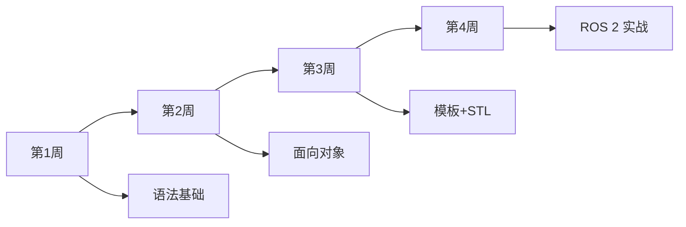
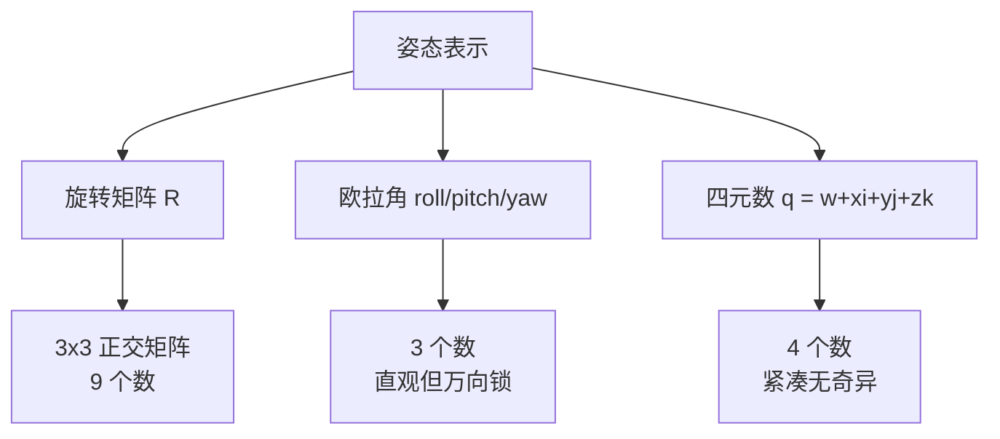

# C++ 与姿态解算学习素材

> [!abstract] 摘要
> 整理**C++ 速成**（针对 ROS 2 / MoveIt 2 编程需求）和**姿态解算**（机器人学核心，含四元数/旋转矩阵/欧拉角/DH/FK/IK）两类素材，按"入门 → 进阶 → 实战"分层，附推荐顺序。

## 一、C++ 学习素材

### 1.1 为什么 ROS 2 方向必须学 C++？

> [!warning] 不是选修
> - MoveIt 2 源码：**95% C++**
> - ros2_control 控制器：**100% C++**
> - Gazebo 插件：**C++**
> - 性能优化层：**只能用 C++**
>
> Python 只能写高层客户端，跑 demo 没问题，做底层必须 C++。

### 1.2 推荐路线（4 周速成）



### 1.3 入门教材（按优先级）

| 优先级 | 资源 | 类型 | 时长 | 说明 |
|--------|------|------|------|------|
| ⭐⭐⭐ | [learncpp.com](https://learncpp.com/) | 在线教程 | 4 周 | **最佳免费 C++ 教程**，从 0 到进阶 |
| ⭐⭐⭐ | 《C++ Primer》第 5 版 | 书 | 4 周 | 经典入门书，覆盖 C++11 |
| ⭐⭐ | 《Effective C++》 | 书 | 2 周 | 进阶必读，条款式 |
| ⭐⭐ | B 站「鱼香ROS - C++ 速成」 | 视频 | 1 周 | 专门为 ROS 2 方向剪的 C++ 内容 |

### 1.4 针对 ROS 2 的 C++ 重点章节

> [!tip] 不需要学完所有 C++
> 只学以下 8 个核心点，足够 ROS 2 / MoveIt 2 编程：

| # | 知识点 | ROS 2 中的应用 |
|---|--------|----------------|
| 1 | 指针、引用、内存管理 | `shared_ptr`、`unique_ptr` 智能指针 |
| 2 | 类、继承、多态 | ROS 2 Node 继承 `rclcpp::Node` |
| 3 | 模板 (template) | 消息类型 `geometry_msgs::msg::Pose` |
| 4 | STL 容器 (vector, map) | 存储轨迹点、关节角 |
| 5 | lambda 表达式 | 回调函数 |
| 6 | 命名空间 | `rclcpp::`、`std::` |
| 7 | CMake 构建 | colcon 依赖 CMakeLists.txt |
| 8 | 异常处理 | 节点初始化失败处理 |

### 1.5 C++ 在 ROS 2 中的最小代码骨架

```cpp
// ROS 2 C++ 节点最简模板
#include "rclcpp/rclcpp.hpp"

class MyNode : public rclcpp::Node {
public:
    MyNode() : Node("my_node") {
        publisher_ = this->create_publisher<std_msgs::msg::String>("topic", 10);
        timer_ = this->create_timer(
            std::chrono::seconds(1),
            std::bind(&MyNode::timer_callback, this)
        );
    }
private:
    void timer_callback() {
        auto msg = std_msgs::msg::String();
        msg.data = "Hello";
        publisher_->publish(msg);
    }
    rclcpp::Publisher<std_msgs::msg::String>::SharedPtr publisher_;
    rclcpp::TimerBase::SharedPtr timer_;
};

int main(int argc, char * argv[]) {
    rclcpp::init(argc, argv);
    rclcpp::spin(std::make_shared<MyNode>());
    rclcpp::shutdown();
    return 0;
}
```

> [!example] 配套 CMakeLists.txt
> ```cmake
> cmake_minimum_required(VERSION 3.16)
> project(my_pkg)
> find_package(rclcpp REQUIRED)
> find_package(std_msgs REQUIRED)
> add_executable(my_node src/my_node.cpp)
> ament_target_dependencies(my_node rclcpp std_msgs)
> install(TARGETS my_node DESTINATION lib/${PROJECT_NAME})
> ```

---

## 二、姿态解算学习素材

### 2.1 姿态解算 = 描述刚体在空间中的"姿态"

> [!info] 三大表示方式
> 任何"刚体在空间中的位姿"都要回答两件事：
> 1. **位置**：x, y, z 三个数
> 2. **姿态**：物体"朝向"，三种数学表示



| 表示 | 数据量 | 优点 | 缺点 | 用途 |
|------|--------|------|------|------|
| **旋转矩阵 R** | 9 个数 | 数学运算友好 | 冗余、需正交化 | 坐标变换 |
| **欧拉角** | 3 个数 (roll/pitch/yaw) | 直观、易调试 | **万向锁**、不连续 | RViz 显示 |
| **四元数** | 4 个数 (x,y,z,w) | 紧凑、无奇异、插值平滑 | 不直观 | 机器人内部 |

### 2.2 必学知识点（按顺序）


### 2.3 推荐教材（机器人学方向）

| 优先级 | 资源 | 类型 | 重点章节 |
|--------|------|------|---------|
| ⭐⭐⭐ | Spong《Robot Modeling and Control》 | 书 | Ch2-3（位姿）、Ch4（DH、FK） |
| ⭐⭐⭐ | Lynch《Modern Robotics》 | 书+视频 | Ch3（旋转）、Ch4（正运动学） |
| ⭐⭐⭐ | [Modern Robotics 视频课](https://modernrobotics.northwestern.edu/) | 视频 | 北卡州大 Kevin Lynch 教授 |
| ⭐⭐ | 《视觉 SLAM 十四讲》第 1-4 章 | 书 | 李群李代数、SO(3)、SE(3) |
| ⭐⭐ | 《State Estimation for Robotics》 | 书 | 卡尔曼滤波 + 四元数 |
| ⭐ | B 站「DR_CAN」机器人学系列 | 视频 | 中文入门 |

### 2.4 ROS 2 中姿态相关的库

| 库 | 用途 | 关键 API |
|----|------|---------|
| **tf2** | 坐标变换 | `tf2::Quaternion`, `tf2::Transform` |
| **Eigen** | 线性代数（推荐必装） | `Eigen::Quaterniond`, `Eigen::Matrix3d` |
| **KDL** | 运动学（MoveIt 默认） | `KDL::ChainFkSolverPos` |
| **Eigen 几何模块** | 几何运算 | `Eigen::AngleAxisd` |

### 2.5 四元数 vs 欧拉角 vs 旋转矩阵转换（C++ 代码）

```cpp
#include <Eigen/Geometry>
#include <tf2/transform_datatypes.h>

// 欧拉角 → 四元数（rpy = roll, pitch, yaw）
Eigen::Quaterniond euler_to_quat(double roll, double pitch, double yaw) {
    return Eigen::Quaterniond(
        Eigen::AngleAxisd(roll,  Eigen::Vector3d::UnitX()) *
        Eigen::AngleAxisd(pitch, Eigen::Vector3d::UnitY()) *
        Eigen::AngleAxisd(yaw,   Eigen::Vector3d::UnitZ())
    );
}

// 四元数 → 旋转矩阵
Eigen::Matrix3d quat_to_matrix(const Eigen::Quaterniond& q) {
    return q.toRotationMatrix();
}

// ROS 2 中 Pose 消息的赋值
geometry_msgs::msg::Pose target_pose;
target_pose.position.x = 0.5;
target_pose.position.y = 0.0;
target_pose.position.z = 0.5;
target_pose.orientation.x = 0.0;
target_pose.orientation.y = 0.0;
target_pose.orientation.z = 0.0;
target_pose.orientation.w = 1.0;  // 单位四元数
```

### 2.6 实战项目（边做边学）

| 难度 | 项目 | 学到的 |
|------|------|--------|
| 入门 | 2 连杆机械臂 FK 手算 + Python 实现 | 旋转矩阵、DH |
| 入门 | 2 连杆机械臂 IK 解析解 | IK 几何法 |
| 进阶 | 用 Eigen 写 6 自由度机械臂 FK | C++ + 矩阵运算 |
| 进阶 | 用 IKFast 生成 6DOF 机械臂解析 IK | MoveIt 实战 |
| 实战 | 在 RViz 中拖拽目标 → MoveIt 输出关节角 | 全链路 |

---

## 三、本周推荐学习顺序

> [!example] 每天 2 小时，按此顺序

| 天 | C++ | 姿态解算 |
|----|-----|---------|
| Day 1 | learncpp Ch0-3（变量、循环、函数） | Lynch Ch3.1 坐标系 |
| Day 2 | learncpp Ch4-7（数组、字符串） | Lynch Ch3.2 旋转矩阵 |
| Day 3 | learncpp Ch9-12（指针、引用） | Lynch Ch3.3 旋转变换 |
| Day 4 | learncpp Ch14-17（类、继承） | Lynch Ch3.4 欧拉角 |
| Day 5 | learncpp Ch18-20（运算符重载） | Lynch Ch3.5 四元数 |
| Day 6 | learncpp Ch21-23（模板） | Lynch Ch3.6 SO(3) |
| Day 7 | 复盘 + 写一个 ROS 2 C++ demo | 完成 3.1-3.6 习题 |

---

## 四、必装工具

> [!tip] 这些工具后续做机器人项目都用得到

| 工具 | 用途 | 安装 |
|------|------|------|
| **Eigen** | C++ 矩阵库 | `sudo apt install libeigen3-dev` |
| **CMake** | 构建系统 | ROS 2 自带 |
| **VSCode + C++ 插件** | IDE | 必装 |
| **ROS 2 Dev Tools** | ROS 开发 | `sudo apt install ros-jazzy-dev-tools` |
| **colcon** | 构建工具 | ROS 2 自带 |

---

## 五、资源汇总（收藏备用）

### C++ 资源
- [learncpp.com](https://learncpp.com/) - 最佳免费教程
- [cppreference.com](https://en.cppreference.com/) - C++ 标准库字典
- 《C++ Primer》第 5 版 - 经典入门
- 《Effective C++》- 进阶必读
- B 站鱼香ROS - 中文 ROS 方向 C++

### 机器人学资源
- [Modern Robotics 课程](https://modernrobotics.northwestern.edu/) - 视频+书
- Spong《Robot Modeling and Control》- 机器人学圣经
- 《视觉 SLAM 十四讲》- 中文，李群李代数
- [tf2 官方教程](https://docs.ros.org/en/jazzy/Tutorials/Intermediate/Tf2/Tf2-Main.html)
- [Eigen 官方教程](https://eigen.tuxfamily.org/dox/GettingStarted.html)

### 在线工具
- [可视化的姿态转换](https://www.andre-gaschler.com/rotationConverter/) - 旋转矩阵/四元数/欧拉角互转
- [3D 四元数可视化](https://quaternions.online/) - 直观理解四元数

---

## 六、与其他笔记的衔接

- [[../起点路线]] - 第 1 周 Week 2 速成 C++
- [[../MoveIt2深入理解]] - MoveIt 2 中 IK/FK 的应用
- [[../README|机器人开发学习计划]] - 总路线

---

> [!note] 更新记录
> - 2026-07-26：整理 C++ 速成与姿态解算学习素材，按 ROS 2 方向剪裁