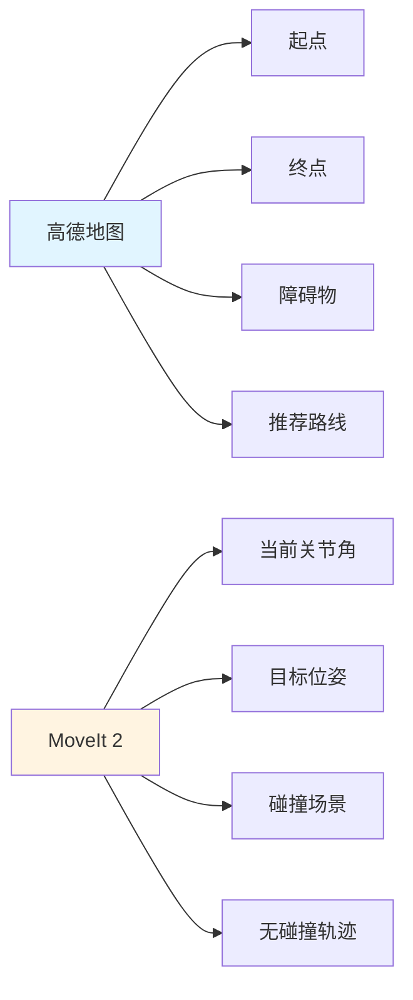
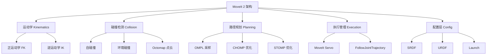
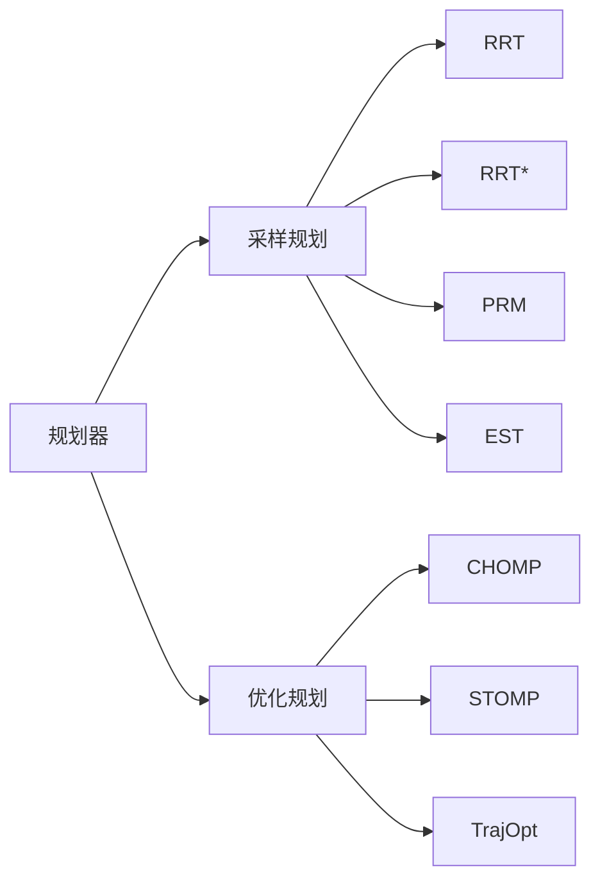
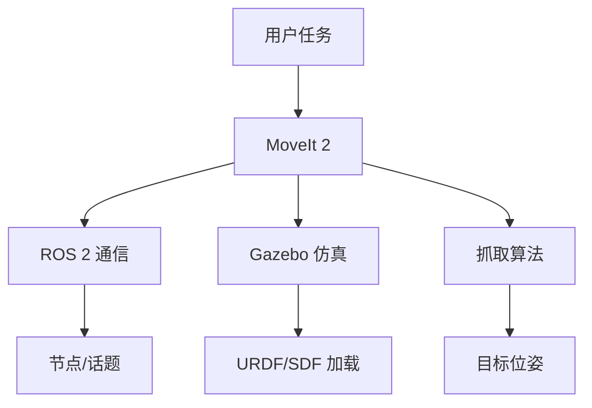
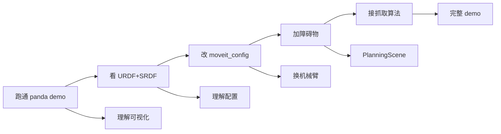

# MoveIt 2 深入理解

> [!abstract] 摘要
> MoveIt 2 是机械臂的"运动规划大脑"。本文用**生活类比 + 架构图 + 代码骨架**三步法，把 MoveIt 2 拆解成 5 个核心问题：是什么、解决什么问题、内部如何工作、为什么这么设计、怎么跑起来。

## 一、一句话理解 MoveIt 2

> [!quote] 核心定义
> **MoveIt 2 = 让机械臂"自动避开障碍，从 A 点安全运动到 B 点"的运动规划软件包。**
> 输入：目标位姿（关节或笛卡尔） + 当前环境
> 输出：一串无碰撞、平滑、可执行的关节轨迹

如果你用过 **百度/高德地图导航**，MoveIt 2 就是机械臂版的"高德地图"：
- **路径规划** = 高德推荐路线
- **碰撞检测** = 实时路况（红绿灯、施工）
- **运动学** = 当前车速与可达性

## 二、生活类比：机械臂的"导航 App"



| 高德地图 | MoveIt 2 | 含义 |
|---------|---------|------|
| 起点 | 当前关节角 | `start_state` |
| 终点 | 目标位姿 | `goal_pose` |
| 路况 | 碰撞场景 | `PlanningScene` |
| 路线 | 关节轨迹 | `robot_trajectory` |
| 重算路线 | 重规划 | `replan` |

## 三、MoveIt 2 内部架构



### 3.1 运动学（Kinematics）— 我能伸到吗？

> [!info] 两个核心问题
> - **正运动学 FK**：给定 6 个关节角度 → 算出末端在哪里
> - **逆运动学 IK**：给定末端位置 → 反推关节角度（这个难，往往多解甚至无解）

```python
# 调用 IK 求解
from moveit_commander import MoveGroupCommander
arm = MoveGroupCommander("panda_arm")
arm.set_pose_target(target_pose)
plan = arm.go()  # 内部自动调用 IK
```

> [!warning] IK 的坑
> IK **不一定能求出解**（工作空间外），也**可能多解**（肘上/肘下）。MoveIt 2 默认返回首个有效解，需要更可控可用 `ikfast` 或 `trac-ik`。

### 3.2 碰撞检测（Collision Checking）— 这条路能不能走？

碰撞检测是 MoveIt 2 性能的关键。每条候选轨迹都要做上千次碰撞检查。

| 碰撞类型 | 检查对象 | 实现 |
|---------|---------|------|
| **自碰撞** | 机器人自身连杆之间 | 包络体（AABB、OBB、凸包） |
| **环境碰撞** | 机械臂 vs 障碍物 | FCL 库 |
| **深度图碰撞** | 相机生成的 Octomap | `occupied_cells_visu` |

> [!tip] 加速技巧
> - 简化 URDF 碰撞几何（用 mesh 而非复杂 STL）
> - 用 `AllowedCollisionMatrix` 标记已知安全对
> - 设置最大距离阈值 `collision_distance`

### 3.3 路径规划（Planning）— 怎么走最划算？

这是 MoveIt 2 的灵魂。规划器分两类：



| 类型 | 代表算法 | 优点 | 缺点 |
|------|---------|------|------|
| **采样规划** | OMPL（RRT、PRM） | 速度快、概率完备 | 路径不平滑 |
| **优化规划** | CHOMP、STOMP | 路径平滑、动力学友好 | 慢、易陷入局部最优 |
| **混合** | OMPL + 后处理 | 工业首选 | 需调参 |

> [!example] OMPL 默认选择
> MoveIt 2 默认用 `RRTConnectkConfigDefault`，适合大多数场景。要切换规划器：
> ```python
> arm.set_planner_id("RRTstarkConfigDefault")
> arm.set_planning_time(5.0)
> ```

### 3.4 执行管理（Execution）— 实际怎么动？

规划好的轨迹只是数学曲线，怎么让电机真的跑起来？


三种执行方式：

1. **仿真执行**：`move_group` → Gazebo → `FollowJointTrajectory`
2. **真机执行**：`move_group` → 机器人控制器 → 伺服
3. **Servo 模式**：`moveit_servo` → 实时位置环（用于视觉伺服、遥操作）

### 3.5 配置层（Config）— 怎么描述机器人？

每次跑 MoveIt 2 都需要一个配置包 `xxx_moveit_config`：

```
panda_moveit_config/
├── config/
│   ├── panda.urdf.xacro        # 机器人描述
│   ├── panda.srdf              # 规划组、虚拟关节、禁用碰撞
│   ├── kinematics.yaml         # IK 求解器配置
│   ├── ompl_planning.yaml      # 规划器参数
│   └── controllers.yaml        # 控制器配置
├── launch/
│   ├── demo.launch.py          # 一键启动 demo
│   └── move_group.launch.py
```

## 四、MoveIt 2 vs MoveIt 1 关键差异

| 维度 | MoveIt 1 (ROS 1) | MoveIt 2 (ROS 2) |
|------|------------------|-------------------|
| 中间件 | ROS 1 (TCP) | ROS 2 (DDS，实时性更好) |
| 控制器 | ros_control | ros2_control |
| Python API | moveit_commander | moveit_py（更现代） |
| 多机协同 | 弱 | 强（原生分布式） |
| 实时性 | 差 | 好（QoS 策略） |
| 默认规划器 | OMPL | OMPL + STOMP |

## 五、MoveIt 2 与三大组件的关系



- **与 ROS 2**：所有 MoveIt 2 节点都是 ROS 2 节点，发布/订阅 trajectory_msgs
- **与 Gazebo**：`move_group` → `FollowJointTrajectory` → Gazebo 执行
- **与抓取算法**：抓取算法输出 6D 位姿 → MoveIt 2 规划轨迹 → 执行

## 六、5 分钟跑通 MoveIt 2（最小 demo）

> [!example] 复制粘贴就能跑
> 1. 启动 demo：
> ```bash
> ros2 launch moveit2_tutorials demo.launch.py rviz_tutorial:=true
> ```
> 2. 在 RViz 中用「MotionPlanning」插件的拖拽小球工具设置目标位姿
> 3. 点 `Plan` → `Execute`，看机械臂动起来

**这一步能让你直观理解 MoveIt 2 的输入输出与可视化。**

## 七、API 三件套：Plan → Execute → Check

```python
from moveit_commander import MoveGroupCommander, PlanningSceneInterface
from geometry_msgs.msg import Pose

# 1. 创建 move group（机械臂组名见 SRDF）
arm = MoveGroupCommander("panda_arm")

# 2. 设置目标（三种方式）
arm.set_pose_target([0.5, 0.0, 0.5, 0, 1, 0, 0])   # 位姿
arm.set_joint_value_target([0, -0.5, 0, -2, 0, 1.5, 0.7])  # 关节角
arm.set_position_target([0.5, 0.0, 0.5])            # 仅位置

# 3. 规划 + 执行
arm.set_max_velocity_scaling_factor(0.1)  # 慢一点更安全
plan = arm.plan()                          # 返回 Plan 对象
arm.execute(plan[1])                       # plan[0]=bool, plan[1]=轨迹

# 4. 添加障碍物到场景
scene = PlanningSceneInterface()
scene.add_box("box", Pose(), (0.1, 0.1, 0.1))  # 名字/位姿/尺寸
```

## 八、常见困惑与解答

> [!faq] 高频问题
> **Q1：URDF 和 SRDF 什么关系？**
> - URDF：描述机器人长什么样（连杆、关节、形状）
> - SRDF：在 URDF 基础上增加**规划语义**（哪些是规划组？哪些自碰撞可忽略？哪些关节是 passive？）
>
> **Q2：为什么 IK 有时候解不出来？**
> - 工作空间外（目标太远）
> - 奇异位姿（雅可比矩阵退化）
> - 关节限位 / 碰撞阻挡
>
> **Q3：规划时间为什么这么长？**
> - 环境太复杂（点云 octomap 太大）
> - 规划算法不合适（试试 RRT* 或 CHOMP）
> - 没设置 `set_planning_time` 上限
>
> **Q4：仿真能跑，真机不行？**
> - ros2_control 控制器没切换到真机 hardware interface
> - URDF 关节限位与真机不一致
> - 速度/加速度参数太大
>
> **Q5：MoveIt 2 和 ros2_control 什么关系？**
> - MoveIt 2：**规划层**（算路径）
> - ros2_control：**执行层**（驱动电机）
> - 两者通过 `FollowJointTrajectory` action 桥接

## 九、推荐学习路径



1. **跑通 demo**：直接 `ros2 launch` 看效果，建立直觉
2. **读配置文件**：看 `xxx_moveit_config` 里有什么，理解每行含义
3. **换机器人**：把自己写的 URDF 生成 MoveItConfig
4. **加障碍物**：用 `PlanningSceneInterface` 加 box
5. **接抓取算法**：相机 → 6D 位姿 → MoveIt 规划 → 执行

## 十、必读资源

| 资源 | 类型 | 链接 |
|------|------|------|
| MoveIt 2 官方教程 | 文档 | [moveit.picknik.ai](https://moveit.picknik.ai/main/index.html) |
| moveit2_tutorials | 代码 | [github.com/moveit/moveit2_tutorials](https://github.com/moveit/moveit2_tutorials) |
| MoveIt 2 论文 | 学术 | "MoveIt 2: The Planning Stack for ROS 2" (2022) |
| OMPL 文档 | 文档 | [ompl.kavraki.unh.edu](https://ompl.kavraki.unh.edu/) |
| 中文视频 | 视频 | B 站「鱼香ROS」「古月居」 |
| ROS Discourse | 社区 | [discourse.ros.org/c/moveit](https://discourse.ros.org/c/moveit/) |

---

## 十一、典型误解澄清（与识别算法的边界）

> [!warning] 常见误解
> **错误理解**：「识别算法负责返回位置，MoveIt 2 负责根据位置算出机械臂应该是什么姿态」
>
> **精准修正**：
> 1. 抓取算法输出不是「位置」，是 **6D 位姿**（位置 x,y,z + 姿态四元数）。因为夹爪合拢方向必须与目标对齐。
> 2. MoveIt 2 输出不是「姿态」，是 **带时间戳的关节轨迹**（JointTrajectory），告诉电机每时刻各关节角度。
> 3. 二者靠**逆运动学(IK)** 桥接：笛卡尔位姿 ↔ 关节角度。


> [!tip] 术语区分
> - 抓取算法的"姿态"：**末端夹爪**在空间的朝向（四元数）
> - MoveIt 2 输出的"姿态"：**各关节**角度（多个值）
> - 两个"姿态"含义完全不同！

---

> [!note] 更新记录
> - 2026-07-26：创建 MoveIt 2 深入理解笔记，从架构、API、生活类比到常见困惑全覆盖
> - 2026-07-26：补充「抓取算法 vs MoveIt 2 输出边界」澄清章节
> - 相关笔记：[[机器人/README|机器人开发学习计划]]、[[具身智能/行业分析|具身智能行业分析]]