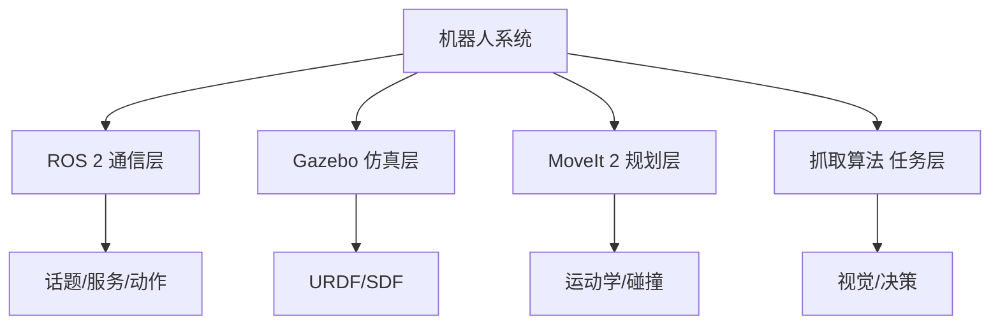
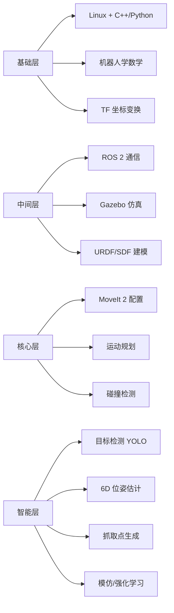
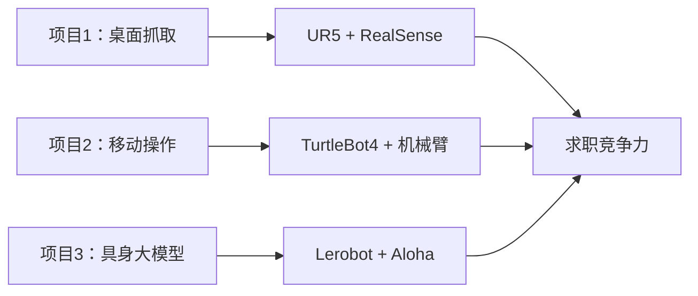

# 机器人开发学习计划

> [!abstract] 摘要
> 本计划聚焦机器人开发四大核心组件：**ROS 2、Gazebo、MoveIt 2、抓取算法**，覆盖从通信中间件、物理仿真、运动规划到任务级感知的完整链路。结合 [[具身智能/行业分析|具身智能行业分析]] 中的产业趋势，给出可落地的学习路线。

## 一、四大组件作用对比

| 组件 | 角色定位 | 核心能力 | 形象比喻 | 行业生态位 |
|------|---------|---------|---------|-----------|
| **ROS 2** | 机器人"操作系统" | 节点通信、硬件抽象、分布式架构、实时性 | Linux 内核 | 所有机器人的基础底座 |
| **Gazebo** | 物理仿真器 | 3D 场景、物理引擎、传感器仿真、ROS 2 集成 | 机器人的"沙盒" | 算法验证的必备环境 |
| **MoveIt 2** | 运动规划框架 | 路径规划、碰撞检测、运动学求解、配置 | 机械臂的"大脑" | 操作类机器人的核心 |
| **抓取算法** | 任务级智能 | 物体检测、6D 位姿估计、抓取点生成 | 机器人的"眼睛+手" | 具身智能落地最后一公里 |

## 二、技术栈全景

## 三、分阶段学习路线

### 阶段一：ROS 2 基础（4-6 周）

> [!info] 学习目标
> 能独立搭建 ROS 2 工程，编写发布者/订阅者/服务/动作，理解 launch 文件与参数服务器。

| 周次 | 内容 | 核心资源 |
|------|------|---------|
| W1 | Linux 命令行 + C++/Python 基础 | 《Linux 命令行大全》 |
| W2 | ROS 2 安装（Humble/Iron/Jazzy） + 工作空间 | [docs.ros.org](https://docs.ros.org/) |
| W3 | 话题(Topic)、服务(Service)、动作(Action) | ROS 2 官方教程 |
| W4 | launch 文件、参数、TF 坐标变换 | tf2 教程 |
| W5 | rclcpp/rclpy 开发，自定义消息 | ROS 2 examples |
| W6 | Nav2 简介（移动机器人导航基础） | Nav2 文档 |

**实操作业**：
- 用 turtlesim 实现键盘控制小乌龟
- 编写多节点通信的 demo
- 跑通官方 `demo_nodes_cpp`

### 阶段二：Gazebo 仿真（3-4 周）

> [!info] 学习目标
> 能独立构建机器人仿真场景，配置传感器，理解物理引擎参数。

| 周次 | 内容 | 核心资源 |
|------|------|---------|
| W1 | URDF / SDF / xacro 建模 | ROS 2 URDF 教程 |
| W2 | Gazebo Sim（原 Ignition）基础 | [gazebosim.org](https://gazebosim.org/) |
| W3 | 传感器仿真（激光、深度相机、IMU） | gazebo_ros_pkgs |
| W4 | ros2_control + 控制器接入 | ros2_control 文档 |

**实操作业**：
- 给自己的机器人写 URDF（机械臂或小车）
- 在 Gazebo 中加载并配置 RGB-D 相机
- 实现差速小车仿真闭环

### 阶段三：MoveIt 2 运动规划（4-6 周）

> [!info] 学习目标
> 能配置 MoveIt 2 完成机械臂运动规划、避障、轨迹执行。

| 周次 | 内容 | 核心资源 |
|------|------|---------|
| W1 | MoveIt 2 架构与 MoveItConfig 生成 | [moveit.ros.org](https://moveit.ros.org/) |
| W2 | OMPL 规划算法（RRT、PRM、CHOMP） | OMPL 文档 |
| W3 | 运动学插件（KDL、IKFast、Trac-IK） | moveit_kinematics |
| W4 | 碰撞检测（self-collision + scene） | PlanningScene |
| W5 | MoveIt 2 + Gazebo 联调（execute + rviz） | moveit_servo |
| W6 | MoveIt Task Constructor（任务级规划） | MTC 教程 |

**实操作业**：
- 用 `panda_moveit_config` 跑通仿真到执行
- 编写自定义机械臂的 MoveItConfig
- 完成"抓取点位姿 → 路径规划 → Gazebo 执行"全链路

### 阶段四：抓取算法（6-8 周）

> [!info] 学习目标
> 掌握从 RGB-D 输入到抓取点生成的完整算法栈，并能集成到 ROS 2 工程。

| 周次 | 内容 | 核心资源 |
|------|------|---------|
| W1 | 传统视觉（点云预处理、分割、配准） | PCL 教程 |
| W2 | 6D 位姿估计（PVN3D、FposeRGBD、FoundationPose） | PoseCNN 系列 |
| W3 | 抓取检测网络（GG-CNN、GR-ConvNet、GraspNet） | GraspNet 论文 |
| W4 | 数据集（YCB-Video、ACRONYM、GRASPNET） | 数据集官网 |
| W5 | GraspNet + ROS 2 集成部署 | graspnet-baseline |
| W6 | 模仿学习（ACT、DP3）与 Diffusion Policy | LeRobot 仓库 |
| W7 | 仿真到真机（Sim2Real）迁移 | NVIDIA Isaac Sim |

**实操作业**：
- 在 GraspNet 上复现一个 baseline
- 把 GG-CNN 部署到 ROS 2 节点
- 完成"相机采集 → 抓取点 → MoveIt 执行"完整 demo

## 四、推荐实战项目

> [!tip] 三个项目覆盖完整链路
> 1. **桌面级机械臂抓取**：UR5/Franka + RealSense + GraspNet
> 2. **移动操作机器人**：TurtleBot4 + 机械臂 + Nav2 + MoveIt
> 3. **具身大模型操控**：Lerobot + Aloha 或真实机械臂 + Diffusion Policy

## 五、关键技术栈速查

| 技术 | 用途 | 推荐版本（2026） |
|------|------|------------------|
| ROS 2 | 通信中间件 | Jazzy Jalisco (LTS) |
| Gazebo Sim | 物理仿真 | Harmonic |
| MoveIt 2 | 运动规划 | 2.13+ |
| ros2_control | 硬件抽象 | Jazzy 默认 |
| Isaac Sim | 高保真仿真 | 2024.1+ |
| GraspNet | 抓取检测 | v1.0+ |
| Lerobot | 具身学习 | HuggingFace 维护 |

## 六、与已有计划的衔接

> [!note] 衔接建议
> - **计算机视觉**（[[计算机视觉]]）：阶段三、四直接复用 CV 基础
> - **具身智能**（[[具身智能/行业分析|具身智能]]）：本计划是技术落地路径
> - **嵌入式部署**（[[转型指南|嵌入式]]）：阶段四的 Sim2Real 与嵌入式相关

## 七、资源清单

### 官方文档
- [ROS 2 官方教程](https://docs.ros.org/en/jazzy/Tutorials.html)
- [Gazebo Sim 文档](https://gazebosim.org/docs)
- [MoveIt 2 教程](https://moveit.picknik.ai/main/index.html)

### 优质课程
- **Stanford CS223A** - 机器人学入门
- **MIT 6.832** - 运动规划
- **ETH Robotics** - ROS 实战
- **古月居** / **鱼香ROS** - 中文社区首选

### 经典开源项目
- [ros2_documentation](https://github.com/ros2/ros2_documentation)
- [moveit2_tutorials](https://github.com/moveit/moveit2_tutorials)
- [graspnet-baseline](https://github.com/graspnet/graspnet-baseline)
- [lerobot](https://github.com/huggingface/lerobot)
- [NVIDIA Isaac Manipulator](https://github.com/NVIDIA-ISAAC-ROS)

### 论文精读
- **MoveIt 2**: "MoveIt 2: The Planning Stack for ROS 2" (2022)
- **GraspNet**: "GraspNet-1Billion: A Large-Scale Benchmark for General Object Grasping" (2020)
- **ACT**: "Learning Fine-Grained Bimanual Manipulation with Low-Cost Hardware" (2023)
- **DP3**: "3D Diffusion Policy" (2024)

## 八、学习方法

1. **每个阶段必做项目**：光看教程不够，必须跑通完整 demo
2. **ROS 2 → Gazebo → MoveIt 2 联调**：仿真闭环是基本功
3. **抓取算法先 baseline 后 SOTA**：GraspNet baseline 已经能落地
4. **真机不是必须**：仿真做扎实 + Sim2Real 是性价比最高的路径
5. **社区参与**：ROS Discourse、Github Issues、知乎"古月居"是日常答疑

---

> [!note] 更新记录
> - 2026-07-26：创建机器人开发学习计划主页，整合 ROS 2 / Gazebo / MoveIt 2 / 抓取算法 四大组件