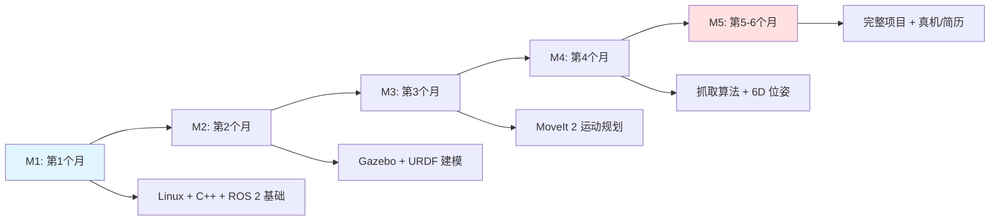
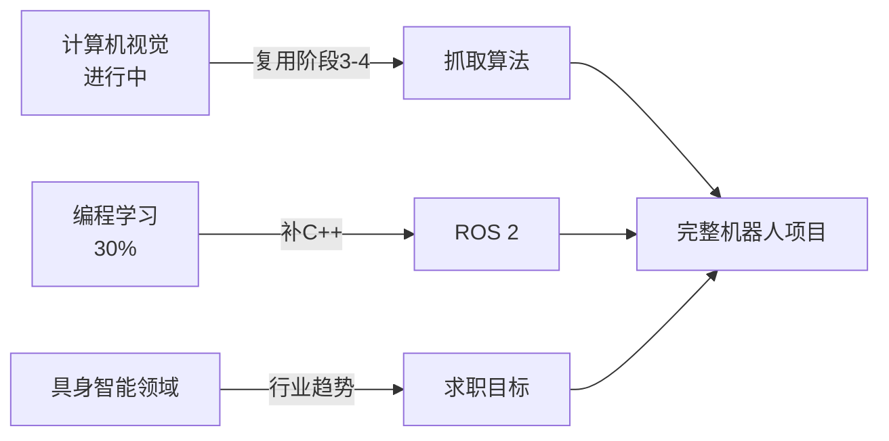

# 机器人方向起点路线（个性化版）

> [!abstract] 摘要
> 基于你的**实际起点**（Python 熟练、CV 在学中、每天 3-4 小时、CV 已完成阶段 1），给出从今天起可以立刻执行的机器人学习路线。不走弯路、不重复造轮，**复用已有的 CV / 编程基础**。

## 一、你的当前起点评估

| 维度 | 现状 | 对机器人方向的价值 |
|------|------|-------------------|
| **Python** | 熟练 | ✅ 直接用于 ROS 2 客户端、抓取算法 |
| **C++** | 未提及 | ⚠️ ROS 2 / MoveIt 2 主要语言，需补 |
| **CV** | 进行中（阶段 1 完成） | ✅ 直接复用，抓取算法=CV任务 |
| **Linux** | 未提及 | ⚠️ 必备，本周补 |
| **机器人学基础** | 零 | ❌ 阶段 1 同步学 |
| **深度学习框架** | CV 阶段 2 会学 | ✅ PyTorch 直接用于抓取算法 |
| **每天时间** | 3-4 小时 | ✅ 充足，建议每天 2h ROS + 1h 算法 |
| **目标方向** | ROS 2 + MoveIt 2 + Gazebo + 抓取 | 清晰的四组件路线 |

> [!tip] 你的核心优势
> CV + Python + 每天 3-4 小时 = 抓取算法方向最优解。别人学半年才到这一步，你 2-3 个月即可。

## 二、总路线图（5 个里程碑）



## 三、本周（第 1 周）必须完成的事

> [!danger] 立即开始
> 不要等"准备充分"。今天就动手。

| 任务 | 时间 | 验收标准 |
|------|------|---------|
| **安装 Ubuntu 22.04**（双系统或 WSL2） | 半天 | 能进系统、能联网 |
| **安装 ROS 2 Jazzy**（2026 LTS） | 半天 | `ros2 run demo_nodes_cpp talker` 能跑 |
| **跑通 turtlesim** | 1 小时 | 键盘控制小乌龟画圆 |
| **买/借 RealSense D435i** | 当天下单 | 抓取必备 |
| **订阅 ROS 2 中文社区** | 30 分钟 | 鱼香ROS、古月居 |

> [!warning] 不要在 Ubuntu 之前犹豫
> 装系统是最大的拦路虎。**本周必须装完**，否则后面所有教程都没法学。

## 四、第 1 个月详细计划

### Week 1：环境 + Linux + ROS 2 入门

| 天 | 学习内容 | 产出 |
|----|---------|------|
| Day 1-2 | 装 Ubuntu 22.04 + ROS 2 Jazzy | 双系统或 WSL2 |
| Day 3 | Linux 基础命令、vim、shell 脚本 | 能写简单脚本 |
| Day 4 | ROS 2 工作空间、colcon build | 建好工作空间 |
| Day 5 | Topic（话题）通信 | 写一个发布者+订阅者 |
| Day 6 | Service（服务）通信 | 写一个加法服务 |
| Day 7 | Action（动作）通信 | 理解长期任务的正确模式 |

> [!example] Day 5 最小 demo
> ```python
> # 跑通才算真的会了
> ros2 run demo_nodes_cpp talker
> ros2 run demo_nodes_cpp listener
> ```

### Week 2：C++ 速成 + ROS 2 进阶

> [!warning] C++ 不是选修
> MoveIt 2 源码、Gazebo 插件、ros2_control 控制器**几乎全是 C++**。Python 只能做高层调用，性能层必须 C++。

| 天 | 学习内容 | 产出 |
|----|---------|------|
| Day 8-9 | C++ 基础（指针、引用、类、模板） | 能读懂 ROS 2 源码 |
| Day 10 | rclcpp 写发布者 | C++ 版 talker |
| Day 11 | launch 文件、参数 | 多节点启动 |
| Day 12 | TF2 坐标变换 | 写 TF 广播+监听 |
| Day 13 | 自定义 msg/srv | 业务消息 |
| Day 14 | 综合：写一个小车控制节点 | 能 cmd_vel 控制 turtlesim |

### Week 3：机器人学基础

> [!info] 机器人学的"四大金刚"
> **正运动学 FK、逆运动学 IK、动力学、轨迹规划**

| 天 | 学习内容 | 产出 |
|----|---------|------|
| Day 15 | 坐标系、位姿表示（旋转矩阵、四元数） | 手算 2 连杆 |
| Day 16 | DH 参数建模 | 写 2 连杆的 DH |
| Day 17 | 正运动学推导 | 推 N 连杆 FK |
| Day 18 | 逆运动学（几何法） | 2 连杆 IK 解析解 |
| Day 19 | Jacobian 雅可比矩阵 | 概念理解 |
| Day 20 | 轨迹规划（梯形/S 曲线） | 仿真轨迹 |
| Day 21 | 推荐书：Spong《Robot Modeling and Control》前三章 | 完成阅读 |

### Week 4：URDF + Gazebo 仿真入门

| 天 | 学习内容 | 产出 |
|----|---------|------|
| Day 22 | URDF 语法（link / joint / transmission） | 写 2 连杆 URDF |
| Day 23 | xacro 宏 | 简化 URDF |
| Day 24 | 在 RViz 中显示 | RViz 可视化 |
| Day 25 | Gazebo Sim Harmonic 安装 | 能打开空场景 |
| Day 26 | SDF 文件 + 加载 URDF 到 Gazebo | 机械臂在 Gazebo 中显示 |
| Day 27 | 加 RGB-D 相机传感器仿真 | 仿真相机出图 |
| Day 28 | ros2_control 控制器 + Gazebo 闭环 | 关节能动 |

## 五、第 2 个月：MoveIt 2 + 抓取基础

### Week 5-6：MoveIt 2 入门

| 周 | 学习内容 | 产出 |
|----|---------|------|
| W5 | 跑通 panda demo、MoveItConfig 生成 | 能改 demo |
| W5 | OMPL 规划算法切换、PlanningScene 加 box | 能加障碍物 |
| W6 | MoveIt Servo 实时控制 | 视觉伺服 demo |
| W6 | MoveIt Task Constructor 任务级 | 任务编排 |

### Week 7-8：抓取算法基础

> [!tip] 复用 CV 阶段 3-4
> 你 CV 已学到阶段 1，**2 个月后**到阶段 4 时，正好对接抓取算法的目标检测/6D 位姿。

| 周 | 学习内容 | 产出 |
|----|---------|------|
| W7 | PCL 点云库基础 | 读懂点云 |
| W7 | 数据集准备：YCB-Video | 下载并可视化 |
| W8 | 6D 位姿估计论文：PoseCNN / PVN3D | 精读 1 篇 |
| W8 | GraspNet baseline 跑通 | 能推理 demo |

## 六、第 3-6 个月：完整项目 + 求职

### Month 3：联调

| 内容 | 产出 |
|------|------|
| GraspNet + MoveIt 2 + Gazebo 全链路 demo | 仿真抓取视频 |
| 6D 位姿 → MoveIt 规划 → Gazebo 执行 | 完整代码 |
| RViz + 相机可视化 | 可演示 |

### Month 4：进阶 + 真机

| 内容 | 产出 |
|------|------|
| Sim2Real：用真机械臂或仿真迁移 | 部署笔记 |
| ACT / Diffusion Policy 入门（接你 CV 基础） | 一篇论文精读 |
| Isaac Sim 高保真仿真体验 | 1 个 demo |

### Month 5-6：作品集 + 求职

| 内容 | 产出 |
|------|参考|
| GitHub 开源作品集 | 3-4 个 star 项目 |
| 技术博客 5 篇 | CSDN/知乎 |
| 简历+面试题 | 投递目标岗位 |

## 七、关键资源（按优先级排序）

> [!tip] 资源使用原则
> **官方 > 系统课程 > 碎片教程**。不要在 B 站几十个教程之间跳转。

| 优先级 | 资源 | 用途 |
|--------|------|------|
| ⭐⭐⭐ | [ROS 2 官方教程](https://docs.ros.org/en/jazzy/Tutorials.html) | 唯一权威教程 |
| ⭐⭐⭐ | [MoveIt 2 官方教程](https://moveit.picknik.ai/) | MoveIt 入门 |
| ⭐⭐⭐ | B 站「鱼香ROS」系统课 | 中文 ROS 2 入门 |
| ⭐⭐⭐ | Spong《Robot Modeling and Control》 | 机器人学圣经 |
| ⭐⭐ | 古月居博客 | 中文 MoveIt/Gazebo |
| ⭐⭐ | [graspnet-baseline](https://github.com/graspnet/graspnet-baseline) | 抓取代码 |
| ⭐ | NVIDIA Isaac Sim 文档 | 高保真仿真 |

## 八、避坑指南（过来人经验）

> [!danger] 常见坑

**坑 1：在装系统上耗一个月**
- 解决：装 Ubuntu 22.04 + ROS 2 Jazhy 这一套最稳，**别追新**

**坑 2：ROS 1 / ROS 2 切换混乱**
- 解决：**只学 ROS 2**，2026 年 ROS 1 已不是主流

**坑 3：只学 Python 不学 C++**
- 解决：MoveIt 2 源码、ros2_control、gazebo_ros_plugins 都是 C++

**坑 4：只跑 demo 不写真机器人项目**
- 解决：第 2 个月开始就要有"完整 demo"的项目作品集

**坑 5：抓取算法一上来就啃 Diffusion Policy**
- 解决：先用 GraspNet baseline 跑通，再用模仿学习

## 九、与其他计划的衔接



- **CV 阶段 3-4**（8 月底-9 月）：直接对接抓取算法
- **编程 C++**（本月补）：为 ROS 2 准备
- **具身智能领域**：决定求职方向（工业/服务/特种）

## 十、每日时间分配建议

> [!example] 每天 3-4 小时分配

| 时段 | 内容 | 时长 |
|------|------|------|
| 早晨 | Linux / C++ / 机器人学理论 | 1 小时 |
| 下午 | ROS 2 / MoveIt 2 / Gazebo 实操 | 1.5 小时 |
| 晚上 | CV 继续 + 抓取算法论文 | 1 小时 |
| 周末 | 综合项目、写笔记、复盘 | 4 小时 |

## 十一、本月产出 checklist

> [!success] 一个月后你应该有这些

- [ ] Ubuntu 22.04 + ROS 2 Jazzy 安装完毕
- [ ] 跑通 turtlesim、talker、listener
- [ ] 写一个 ROS 2 C++ 发布者
- [ ] 理解 TF 坐标变换
- [ ] 完成 2 连杆 DH 建模
- [ ] 写一个 2 连杆 URDF 并在 RViz 显示
- [ ] Gazebo 加载 URDF + RGB-D 相机
- [ ] ros2_control 让关节能动
- [ ] 笔记整理到 Obsidian（你已经做得很好了）

---

> [!note] 更新记录
> - 2026-07-26：基于你 CV / 编程 / 每天 3-4h 现状，定制机器人起点路线
> - 相关笔记：[[机器人/README|机器人开发学习计划]]、[[MoveIt2深入理解]]、[[具身智能/行业分析|具身智能行业分析]]