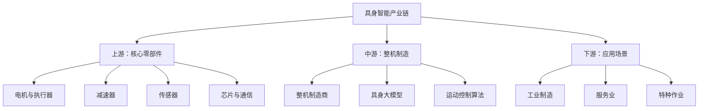
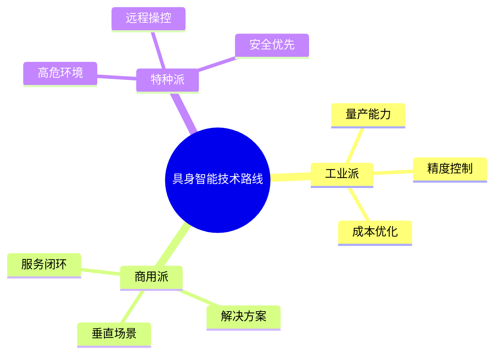
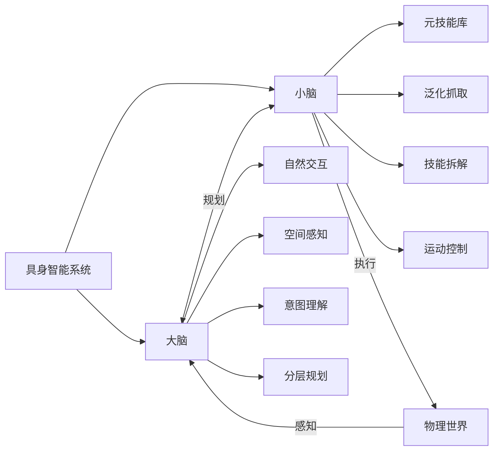
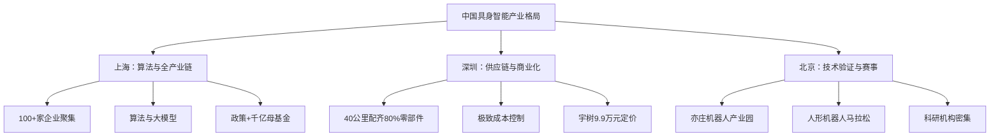
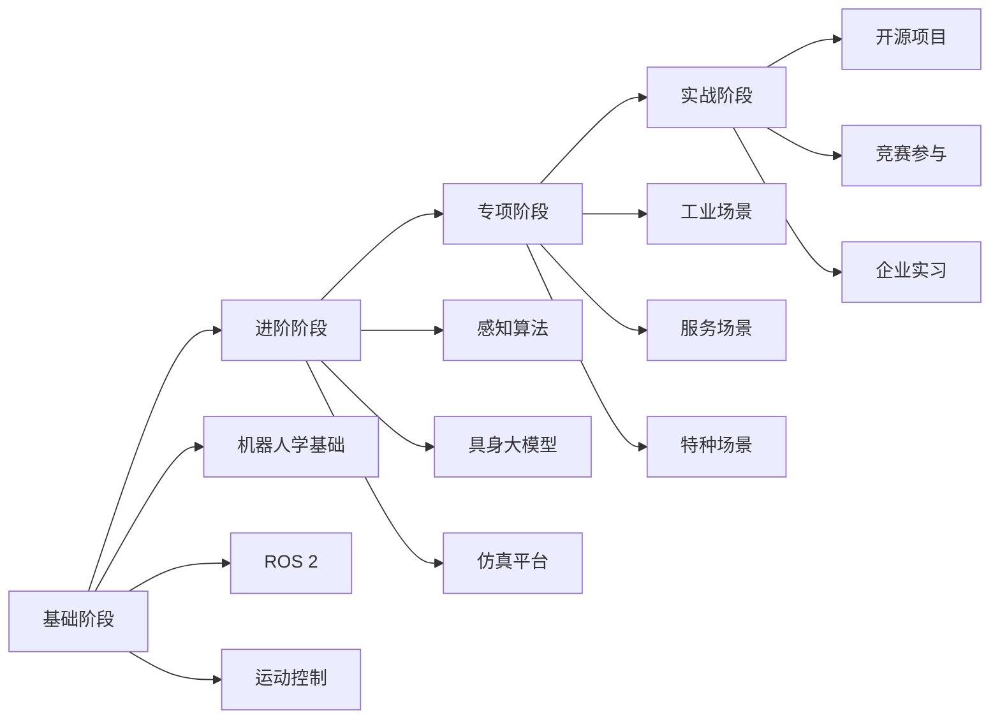

# 具身智能行业分析

> [!abstract] 摘要
> 具身智能（Embodied Intelligence）是融合人工智能与机器人技术，让智能体通过物理实体与环境实时交互的新一代人工智能方向。2025年被列入国家未来产业重点培育清单，市场前景广阔。

## 一、行业定义

### 什么是具身智能

**具身智能**（Embodied Intelligence）是指智能体通过物理实体与环境实时交互，实现感知、认知、决策和行动一体化的智能系统。

> [!quote] 核心区别
> 传统AI（如DeepSeek、ChatGPT）停留在文字描述的世界里，缺乏真实世界体验。而具身智能机器人能够"看、听、摸、动、试"，在动态互动中不断学习和进化。

### 技术特征

| 特征 | 描述 | 技术支撑 |
|------|------|----------|
| **感知** | 理解物理环境 | 视觉、触觉、听觉多模态感知 |
| **认知** | 理解任务意图 | 大语言模型、多模态理解 |
| **决策** | 规划行动方案 | 强化学习、模仿学习 |
| **执行** | 执行物理动作 | 运动控制、灵巧操作 |

## 二、市场规模与政策

### 全球市场规模

| 年份 | 全球规模 | 中国规模 | 中国占比 |
|------|---------|---------|----------|
| 2025 | 195.25亿元 | 52.95亿元 | 27% |
| 2030 | 2326.3亿元 | 1037.52亿元 | 44.6% |
| 2035 | 万亿级 | 4000亿+ | - |

> [!info] 市场预测
> 中国具身智能产业市场规模有望在2030年达到4000亿元、2035年突破万亿元。

### 中国政策支持

- **2025年《政府工作报告》**：首次将"具身智能"列入国家未来产业重点培育清单
- **工信部《人形机器人创新发展指导意见》**：明确2027年综合实力达到世界先进水平
- **上海目标**：2030年末推动**10万台**人形机器人进入本地工厂

### 2025年发展里程碑

- 全球人形机器人出货量：**1.44万台**
- 中国占比：**84.7%**
- 进入生产场景比例：**超过80%**（从展示向生产力转型）

## 三、产业链结构

### 产业链全景图

### 上游核心零部件

#### 电机与执行器

| 零部件 | 国产化率 | 代表厂商 | 技术水平 |
|--------|---------|---------|----------|
| 无框力矩电机 | 高 | 国产优势明显 | 国际先进 |
| 谐波减速器 | 高 | 绿的谐波等 | 国际先进 |
| 行星滚珠丝杠 | ~30% | 拓普集团等 | 持续突破 |
| 空心杯电机 | 低 | 国内追赶中 | 接近国际 |
| 灵巧手 | 中 | 多个厂商 | 快速进步 |

#### 传感器

| 传感器类型 | 国产化率 | 技术难度 | 发展趋势 |
|------------|---------|---------|----------|
| 六维力传感器 | 低→中 | 高 | 持续突破 |
| 视觉传感器 | 高 | 中 | 成熟 |
| IMU | 中 | 中 | 成熟 |
| 触觉传感器 | 低 | 高 | 研发中 |

#### 芯片

- **SoC芯片**：华为昇腾、地平线征程系列
- **NPU**：专用神经网络处理器
- **通信模组**：5G、WiFi6

### 中游整机制造

#### 主要玩家分布

| 企业 | 产品 | 定位 | 特色 |
|------|------|------|------|
| **智元机器人** | 远征A3、精灵G2 | 工业量产 | 全球39%市场份额 |
| **宇树科技** | G1、H1 | 性价比 | 3.99万元级定价 |
| **优必选** | Walker S | 全尺寸工业 | 本田、西门子合作 |
| **银河通用** | Galbot | 商用服务 | 零售场景 |
| **特斯拉** | Optimus | 通用人形 | 上海建厂中 |

#### 技术路线

### 下游应用场景

#### 工业制造（最快落地）

- **汽车制造**：精密装配、零部件搬运
- **3C电子**：11.6秒节拍高速产线
- **新能源**：电池组装、光伏生产

#### 服务机器人

- **零售**：商品识别、自主导航
- **餐饮**：无人餐厅、咖啡制作
- **酒店**：导览、配送

#### 特种作业

- **电力巡检**：变电站无人化运维
- **危险环境**：化工厂、矿山
- **救援**：灾害救援、反恐

## 四、核心技术

### 大脑-小脑架构

### 关键技术栈

| 技术层级 | 关键技术 | 学习难度 |
|---------|---------|---------|
| **感知** | 视觉SLAM、深度估计、触觉感知 | ⭐⭐⭐⭐ |
| **认知** | 多模态大模型、意图理解 | ⭐⭐⭐⭐⭐ |
| **决策** | 强化学习、运动规划 | ⭐⭐⭐⭐ |
| **执行** | 运动控制、力控、柔顺控制 | ⭐⭐⭐⭐ |
| **硬件** | 电机控制、传感器融合 | ⭐⭐⭐ |

### 具身大模型（VLA）

**VLA（Vision-Language-Action）** 是具身智能的核心技术：

- **视觉理解**：环境感知、物体识别
- **语言理解**：指令解析、任务规划
- **动作生成**：运动控制、操作执行

> [!warning] 技术挑战
> 全行业高质量具身数据仅约50万小时，与GPT-5训练的100亿小时语料差距达万倍量级。

## 五、区域竞争格局

### 中国三大高地

| 区域 | 核心优势 | 代表企业 | 发展目标 |
|------|---------|---------|----------|
| **上海** | 全产业链、政策支持 | 智元机器人 | 10万台进厂 |
| **深圳** | 供应链、成本控制 | 宇树科技 | 2027年千亿规模 |
| **北京** | 科研、赛事驱动 | 中科院等 | 技术前沿 |

## 六、人才需求

### 人才缺口现状

> [!danger] 人才危机
> 机器人领域技术人才的需供比高达 **5.2:1**，既懂机械工程又懂AI算法的复合型人才极度稀缺。

### 紧缺岗位

| 岗位 | 技能要求 | 薪酬范围(3年) |
|------|---------|---------------|
| 机器人感知算法工程师 | 视觉SLAM、点云处理 | 40-60万 |
| 具身智能算法研究员 | VLA模型、强化学习 | 50-80万 |
| 运动控制工程师 | PID、力控、轨迹规划 | 35-55万 |
| 嵌入式AI工程师 | 边缘部署、实时系统 | 40-60万 |
| 机器人产品经理 | 技术理解、产品设计 | 30-50万 |

### 人才培养

- **教育部审批**：50个国家级现代产业学院
- **校企合作**：72所高校建立智能基座
- **课程体系**：1600门AI相关课程

## 七、就业建议

### 适合人群

> [!tip] 适合转型的人群
> - 嵌入式工程师（有硬件基础）
> - 机器人学背景（运动控制经验）
> - 计算机视觉工程师（有感知经验）
> - 控制理论背景（运动规划）

### 学习路径

### 资源推荐

- **仿真平台**：Isaac Sim、Gazebo、PyBullet
- **开源项目**：ROS机器人操作系统
- **学习资料**：斯坦福机器人课程、MIT运动规划
- **竞赛**：人形机器人马拉松、机器人格斗赛

## 八、相关笔记

- [[边缘智能行业分析]] - 边缘AI技术栈
- [[嵌入式工程师转型指南]] - 转型路径规划
- [[AI算子开发技术栈]] - 算子开发核心技术

---

> [!note] 更新记录
> - 2026-05-19：创建笔记，整合具身智能行业分析

