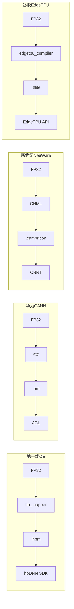

# NPU 横向对比（BPU / NPU / TPU / MLU / DSP）

> [!abstract] 摘要
> 端侧 AI 加速器（地平线 BPU、华为昇腾 NPU、寒武纪 MLU、高通 Hexagon NPU、谷歌 Edge TPU、苹果 ANE）的工作流几乎一致：FP32 模型 → 量化 → 编译 → 板端推理。本笔记横向对比各家加速器的特性、工具链、约束差异。

> [!info] 关系
> 主笔记：[[旭日5算法工具链]] —— 详细讲地平线 X5
> 相关：[[../华为昇腾/开发指南]] —— 详细讲昇腾

---

## 一、各家加速器定位速查

| 加速器 | 厂商 | 典型场景 | 数据格式 |
|--------|------|----------|----------|
| **BPU** | 地平线 | 智能机器人/IoT | INT8 / INT16 |
| **NPU** | 华为昇腾 | 边缘 / 云端 | INT8 / FP16 |
| **MLU** | 寒武纪 | 边缘 / 云端 | INT8 / INT16 |
| **Hexagon NPU** | 高通 | 移动端 | INT8 / FP16 |
| **Edge TPU** | 谷歌 | IoT / Coral | **INT8 only** |
| **ANE** | 苹果 | iOS / Mac | INT8 / FP16 |
| **DSP** | Qualcomm Hexagon | 通用 DSP 加速 | INT8 |
| **GPU NVDLA** | 英伟达 | 开源 IP | INT8 |

---

## 二、共同点（"都这样"的部分）

| 环节 | 内容 |
|------|------|
| **数据精度** | INT8 是行业基准（Edge TPU 强制 INT8） |
| **模型来源** | 主流：ONNX；厂商有自家偏好的输入格式 |
| **量化方式** | PTQ（训练后）+ QAT（量化感知） |
| **工具链** | 厂商自家工具链：OE 天工开物 / CANN / NeuWare / SNPE / edgetpu_compiler / CoreML |
| **运行时** | SDK 封装 API：hbDNN / ACL / CNRT / QNN / EdgeTPU / CoreML |
| **协同** | 通用 CPU + 加速器（异构执行） |
| **算子表** | 必有的"支持清单 + 约束文档" |

### 共同的设计哲学

1. **硬件只懂 INT8 定点** → 必须量化
2. **不通用、只跑算子** → 必须有"算子支持清单"
3. **全跑硬件不现实** → 必须有 CPU fallback / 异构
4. **量化会掉精度** → 必须有 PTQ 校准 + QAT 重训
5. **硬件不直接被调** → 必须有 SDK 封装好 API

---

## 三、差异点（"各家不同"的部分）

| 维度 | 区别 |
|------|------|
| **精度选择** | Edge TPU **只支持 INT8**（最严），其他家多数支持 INT8 + FP16 |
| **量化粒度** | 地平线/昇腾支持 per-tensor / per-axis / per-channel；有些只支持 per-tensor |
| **算子自由度** | 寒武纪/昇腾更"通用"（支持更多算子），Edge TPU 最"窄"（很多 op 不支持） |
| **动态 shape** | 大多数端侧 NPU 都不支持 batch>1、动态 shape，模型必须 export 时定死 |
| **自定义算子** | 地平线/昇腾/寒武纪允许；TPU/ANE 完全封闭 |
| **框架耦合** | Edge TPU 强绑 TF Lite；ANE 强绑 CoreML；地平线/昇腾/寒武纪比较开放 |
| **工具链难度** | 地平线 OE 算"半自动"（脚本化）；昇腾 CANN 最复杂；苹果 CoreML 最傻瓜 |
| **生态开放** | 寒武纪 / 地平线较开放；Edge TPU/ANE 封闭 |

---

## 四、概念对应表（行业术语对照）

| 行业通用叫法 | 地平线叫法 | 备注 |
|--------------|-------------|------|
| NPU / AI Accelerator | BPU | 厂商各自命名 |
| Heterogeneous Executable Graph | 混合异构模型 | 同一概念 |
| Compiled Model / .nb / .nn / .tflite | .hbm | 编译后产物 |
| Post-Training Quantization | PTQ | 通用术语 |
| Quantization-Aware Training | QAT | 通用术语 |
| Inference Runtime / ACL / CNRT | hbDNN SDK | 推理库 |
| 算子调度策略 | 主动/被动量化 | 各家实现方式不同 |

---

## 五、典型工作流对比



| 厂商 | 量化工具 | 编译工具 | 产物格式 | 推理 API |
|------|----------|----------|----------|----------|
| 地平线 | hb_mapper (PTQ/QAT) | hb_mapper | `.hbm` | `hbDNN*` |
| 华为昇腾 | AMCT / MindSpore | ATC | `.om` | ACL |
| 寒武纪 | NeuWare Quantizer | CNML | `.cambricon` | CNRT / BangC |
| 高通 | SNPE | SNPE | `.dlc` | QNN |
| 谷歌 | TFLite Quantizer | edgetpu_compiler | `.tflite` | EdgeTPU Runtime |
| 苹果 | CoreML Tools | XCode 自动 | `.mlmodel` | CoreML |

---

## 六、算子支持度对比（粗略）

| 加速器 | BPU 加速算子数 | CPU fallback | 备注 |
|--------|----------------|--------------|------|
| 地平线 BPU | ~29 | ~18 | 视觉模型友好 |
| 华为昇腾 | ~80+ | ~30 | 最通用 |
| 寒武纪 MLU | ~60+ | ~20 | 通用 |
| 高通 Hexagon | ~40+ | ~20 | 移动端优化 |
| 谷歌 Edge TPU | ~20 | 无 | 强制量化，强约束 |
| 苹果 ANE | 隐藏 | - | 完全封闭，由 CoreML 自动决定 |

> [!warning] "算子表" 与 "加速器强不强" 是反相关
> - **苹果 ANE**：完全封闭，但写 Swift/CoreML 你根本不用关心算子
> - **Edge TPU**：算子表最短（≈20 个），但"凡是不支持的直接报错"很烦
> - **地平线 BPU**：算子表中等（~30 个 BPU + ~20 个 CPU fallback），覆盖度适合视觉模型
> - **昇腾/寒武纪**：算子表最长（~100+），最通用

---

## 七、各家踩坑点

### 地平线 BPU
- 仅支持 ONNX opset10/11
- TF2.x 仍实验性
- Deconv pads 必须对称
- Softmax 默认 CPU，跑 BPU 需显式 `run_on_bpu`

### 华为昇腾
- 算子与 MindSpore 强耦合
- CANN 学习曲线陡
- 910 系列需申请，环境搭建复杂

### 寒武纪 MLU
- 工具链文档偏少
- 算子与 PyTorch 兼容度需逐个验证

### 谷歌 Edge TPU
- **只支持 INT8**（FP16/FP32 直接报错）
- 算子支持表很窄，复杂模型要重构
- 强绑 TF Lite，其他框架需转换

### 苹果 ANE
- 强绑 CoreML/iOS
- 不能直接控制，全部由系统调度

---

## 八、工程师视角的"三步走"（通用）

不管哪家加速器，上车套路都是：

```
1. 训练一个 FP32 模型 (PyTorch/TF)
        ↓
2. 用工具链量化 (PTQ 优先，不行再 QAT) → 得到 INT8 模型
        ↓
3. 用工具链编译 → 得到 .hbm / .om / .nb / .tflite
        ↓
4. 在板上用 SDK 加载 → 输入数据 → 拿推理结果
```

文档结构也是同一个模板：
- 产品简介 → 关键概念 → 环境安装 → 快速入门
- 量化原理 → 调优 → 嵌入式 SDK → API → 模型 Benchmark → 算子支持表

---

## 九、选型建议

| 场景 | 推荐 |
|------|------|
| 国产机器人 / IoT / 智能摄像头 | **地平线 BPU** 或 **华为昇腾** |
| 移动端（手机） | 高通 Hexagon NPU / 苹果 ANE |
| 强 TF 生态 | Edge TPU（但要小心算子约束） |
| 学术 / 云端训练 | 英伟达 GPU + TensorRT（不算 NPU） |
| 国内车规 | 地平线征程 J5/J6、华为 MDC |

---

## 十、相关笔记

- [[旭日5算法工具链]] —— 地平线 X5 详细
- [[../华为昇腾/开发指南]] —— 华为昇腾详细
- [[../AI算子开发/技术栈]] —— 算子开发通用知识
- [[../边缘智能/行业分析]] —— 行业分析
- [[../../../04 - Resources/AI模型部署/模型量化]] —— 量化原理

## 十一、待补充

- [ ] 实际跑一遍各家的 PTQ 流程
- [ ] 同一模型在 BPU / 昇腾 NPU / TFLite GPU 三端的 benchmark 对比
- [ ] 调研国产新兴 AI 芯片（黑芝麻、芯驰、亿咖通）
- [ ] 关注车规级 NPU 趋势（征程 J6、昇腾 950）
