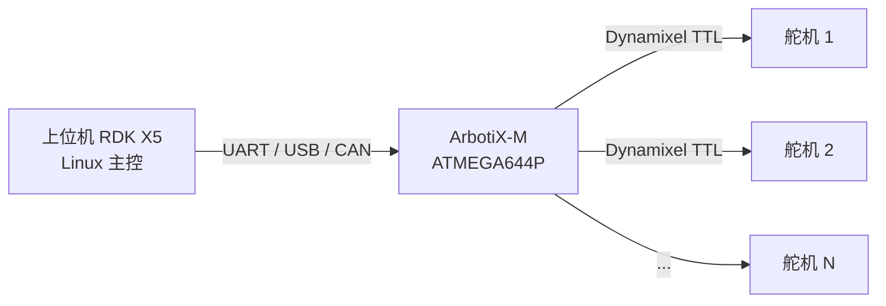

# ArbotiX-M 开发板使用笔记

> [!abstract] 摘要
> ArbotiX-M 是一款兼容 Arduino 的机器人控制板，专为控制 Dynamixel 舵机设计。本文记录其硬件特性、与上位机的通信方式、常见问题排查(p设备描述符请求失败)、以及烧录测试的完整过程。

## 一、硬件概述

### 核心特性

ArbotiX-M 是 Vanadium Labs 推出的 ArbotiX 精简版（M 代表 Mini，体积比原版小 25%），专用于控制中小型机器人。

| 特性 | 说明 |
|------|------|
| **MCU** | AVR ATMEGA644P，16MHz，8-bit |
| **数字 I/O** | 28 路（其中 8 路可作模拟输入） |
| **引脚接口** | 全部 I/O 为舵机式 3pin 排针（GND/VCC/Signal） |
| **Dynamixel 端口** | 3 个 TTL 3pin 通信口 |
| **无线扩展** | 预留 XBee 无线模块插槽 |
| **开源** | Open Hardware（GPL 3） |

### 支持的 Dynamixel 舵机

- AX-12A、AX-18A、AX-12W
- MX-28T、MX-64T、MX-106T

### 能力边界

- 最多可控制约 30 个 Dynamixel 舵机
- 适用于足式机器人、机械臂等构建

> [!warning] 重要限制
> ArbotiX-M 基于 **AVR ATMEGA644P**（8-bit MCU），**不能刷 Linux**。它属于下位机/舵机执行控制板，需要配合上位机（如 RDK X5）使用。

## 二、系统架构与通信

ArbotiX-M 本身不自带系统，需配合上位机组成完整机器人控制系统：

- **上位机**：运行 Linux 的计算单元，负责算法、规划
- **ArbotiX-M**：下位机，负责实时舵机控制（PWM / 角度回读）
- **通信**：通过 UART、USB 或 CAN 与上位机对接

## 三、供电说明

> [!important] 需单独 12V 供电
> ArbotiX-M 上的 3-pin 接口同时承载舵机的 **信号与电源**。驱动 Dynamixel 舵机时必须单独接入 **12V** 电源，USB 供电不足以驱动舵机。接线时注意 **GND 必须共地**。

## 四、烧录准备（Arduino IDE）

### 1. 安装板型支持包

ArbotiX-M 的硬件描述与库来自 GitHub 仓库 [ArbotiX-M](https://github.com/bouraqadi/ArbotiX-M.git)，需要拷贝到 Arduino IDE 的工作目录（默认在 `文档/Arduino` 下）。

### 2. 选择板型

在 Arduino IDE 中，**工具 → 开发板** 选择 **ArbotiX Std**：

- 不要选 Mega 2560 之类的通用板型
- 选择 ArbotiX Std 才能正确匹配 ATMEGA644P 的熔丝位与 Bootloader

### 3. 端口选择

插入后识别为 **COM6**（以设备管理器实际为准）。

### 4. 烧录流程（以 Blink 为例）

1. 安装 Arduino IDE 及 ArbotiX-M 支持包
2. 工具 → 开发板 → 选择 **ArbotiX Std**
3. 工具 → 端口 → 选择 **COM6**
4. 上传 **Blink** 程序
5. 用 115200 波特率串口命令测试，观察板子返回信息

## 五、常见问题排查

### 问题1：插入后“设备描述符请求失败”

> [!bug] 现象
> 插入 USB 后，系统提示 `Device Descriptor Request Failed`，设备管理器中设备无法正常识别。

**排查与解决步骤：**

1. **更换 USB 数据线**（优先排除劣质/仅充电线）
2. **更换 USB 端口**（避免使用前置/扩展坞端口，尝试直连主板 USB 口）
3. **卸载 USB 控制器驱动后重装**：
   - 设备管理器 → 通用串行总线控制器
   - 卸载相关 USB Root Hub / 控制器
   - 右键 → 扫描检测硬件改动，让系统重装驱动

### 问题2：插上后电源/共地错误导致舵机不响应

- 确认 12V 电源接入且 GND 共地
- 确认板型选择正确（ArbotiX Std）

### 问题3：烧录报超时 / stk500v2_getsync() failed

- 往往是板型选错（误选 Mega 2560）导致
- 改选 **ArbotiX Std** 即可解决

## 六、测试记录

### 2026-10-07 验证成功（板子本体）

- 端口：**COM6**
- 板型：**ArbotiX Std**
- 结果：串口命令测试，板子成功返回 `LED ON` / `LED OFF`
- 结论：MCU 烧录成功、串口通信（115200）正常、板载功能验证通过

### 2026-10-07 舵机控制测试成功（5 自由度机械臂）

- **设备**：5 自由度机械臂，5+ 个 Dynamixel 舵机
- **单舵机测试**：位置读写、扭矩锁定、目标位置转动 全部正常
- **安全问题**：默认速度太快（满速）有危险，需限速
- **限速解法**：调用 `dxlSetGoalSpeed(id, speed)`，速度值 0~1023，越小越慢（如 30 约 3% 满速）
- **编程要点**：本库使用**按字节拆分**的寄存器常量（`AX_*_L` / `AX_*_H`），且提供高层函数更简洁：
  - `dxlTorqueOn(id)` / `dxlTorqueOff(id)` —— 扭矩使能
  - `dxlGetPosition(id)` —— 读当前角度
  - `dxlSetGoalPosition(id, pos)` —— 设目标位置
  - `dxlSetGoalSpeed(id, speed)` —— 设目标速度（限速关键）

> [!warning] 安全提示
> - 测舵机务必先 `dxlSetGoalSpeed` 设低速再转动，避免满速伤人/损坏机构
> - 转动时手远离舵机活动范围

> [!success] 下一步
> 多舵机控制 / 机械臂联动（多舵机同步、各关节独立目标角度、连续轨迹）。

### 2026-10-07 多舵机测试与 AX-12 疑难排查

**现象：**
- 机械臂 5 自由度，舵机 ID 1~5
- 逐关节动作时，有时某些关节"读得到角度但完全不动"，且**每次不动的是不同关节**
- 用固定绝对位置、回归复刻仍偶发不动，**重启后恢复正常**

**排查要点（AX-12 系列通用）：**
1. **读得到但不动 ≠ 硬件坏**，先怀疑舵机进入**过温/过流保护锁死**状态，重启供电即可恢复
2. 目标位置 `curPos + 偏移` 可能**超过 0~1023 范围**，超限指令舵机会忽略 → 用**绝对位置**（如 300/512）测试更确定
3. 怀疑扭矩未使能时，回读 `dxlGetTorqueEnable(id)` 确认寄存器值是否为 1
4. 底关节承重最大，可适当提高目标速度（如 200）排除扭矩不足
5. **交互式测试比 arrays 循环更好用**：串口输入 ID 单独测，输入 `r` 全量扫描，输入 `f` 扭矩全关

> [!warning] 经验
> "读得到角度但不动"时，优先：断电重启 → 读扭矩寄存器 → 换绝对位置 → 提速度，逐层排除。

## 七、相关笔记

- [[转型指南]] - 嵌入式工程师向具身智能方向转型路径（含机器人学入门）

---

> [!note] 更新记录
> - 2026-10-07：创建笔记，记录硬件概览、烧录流程、问题排查与测试结果
> - 2026-10-07：记录舵机控制测试成功（5 自由度机械臂），补充限速方法与本库高层函数用法
> - 2026-10-07：补充多舵机测试记录与 AX-12 "读得到但不动"疑难排查经验