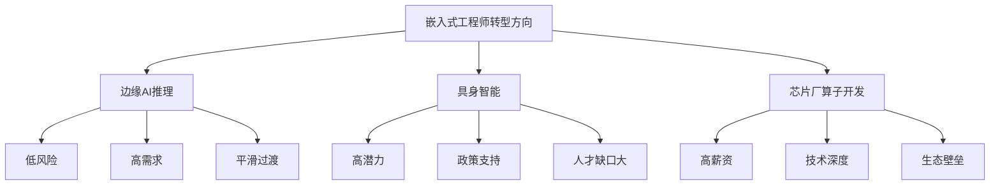

# 嵌入式工程师转型指南

> [!abstract] 摘要
> 本指南针对嵌入式软件工程师向边缘AI、具身智能等领域转型的完整路径，包括技能分析、转型方向、学习计划和资源推荐。

## 一、嵌入式工程师的优势

### 核心技能迁移

作为嵌入式工程师，你已经具备以下**高价值技能**，这些在AI领域非常稀缺：

> [!success] 你的优势
> - **C/C++编程能力**：AI推理引擎的核心语言
> - **硬件理解**：芯片架构、内存层级、外设驱动
> - **资源受限优化**：嵌入式设备的性能调优经验
> - **实时系统设计**：RTOS、实时性保证
> - **低功耗设计思维**：能效比优化意识

### 技能匹配度对比

| 嵌入式技能 | AI领域应用 | 匹配度 |
|------------|-----------|--------|
| C/C++ | 推理引擎开发、算子实现 | ⭐⭐⭐⭐⭐ |
| 内存管理 | 模型量化、内存优化 | ⭐⭐⭐⭐⭐ |
| 硬件调试 | NPU/AI芯片调试 | ⭐⭐⭐⭐⭐ |
| RTOS经验 | 机器人实时控制 | ⭐⭐⭐⭐ |
| 传感器驱动 | 机器人感知系统 | ⭐⭐⭐⭐ |
| 通信协议 | 分布式AI系统 | ⭐⭐⭐⭐ |

## 二、转型方向分析

### 三大转型方向



### 方向对比

| 方向 | 优势 | 劣势 | 适合度 |
|------|------|------|--------|
| **边缘AI推理** | 技能重叠高、需求大、易上手 | 竞争激烈 | ⭐⭐⭐⭐⭐ |
| **具身智能** | 政策支持、人才缺口大 | 需补充机器人学 | ⭐⭐⭐⭐ |
| **芯片厂算子开发** | 薪资高、技术护城河深 | 需深入学习特定芯片 | ⭐⭐⭐⭐ |

> [!tip] 推荐
> **优先选择边缘AI推理方向**，原因：
> 1. 与现有技能重叠度高，风险低
> 2. 市场需求大、就业机会多
> 3. 可以在职学习，平滑过渡

## 三、转型路径一：边缘AI推理工程师

### 技能缺口分析

```
当前技能                需补齐短板
├── C/C++编程       →   Python数据处理
├── 硬件驱动/外设    →   NPU/DSP异构编程
├── RTOS/Linux经验   →   模型压缩部署
├── 资源受限优化     →   TensorFlow Lite/ONNX
└── 低功耗设计       →   端侧AI能效优化
```

### 学习计划（6个月）

#### 阶段1：AI基础（1-2个月）

| 周次 | 学习内容 | 目标 |
|------|---------|------|
| 1-2 | Python基础、数据处理 | 熟练使用NumPy/Pandas |
| 3-4 | 机器学习基础 | 理解监督/无监督学习 |
| 5-6 | 深度学习基础 | CNN/RNN原理 |
| 7-8 | PyTorch框架 | 能跑通经典模型 |

**推荐资源：**
- 吴恩达机器学习课程
- 李宏毅机器学习（YouTube）
- PyTorch官方教程

#### 阶段2：模型轻量化（2-3个月）

| 周次 | 学习内容 | 目标 |
|------|---------|------|
| 9-10 | 模型量化原理 | INT8量化实战 |
| 11-12 | 剪枝与蒸馏 | 模型压缩技术 |
| 13-14 | TensorFlow Lite | 端侧部署基础 |
| 15-16 | ONNX Runtime | 跨框架部署 |

**实战项目：**
- YOLOv5模型量化部署
- ResNet端侧推理优化

#### 阶段3：边缘系统集成（2-3个月）

| 周次 | 学习内容 | 目标 |
|------|---------|------|
| 17-18 | Edge Impulse | 快速原型开发 |
| 19-20 | STM32 AI套件 | MCU上的AI部署 |
| 21-22 | Jetson平台 | 边缘计算实战 |
| 23-24 | 端到端项目 | 完成完整项目 |

**实战项目：**
- 工业质检系统（基于Jetson）
- 智能摄像头目标检测

### 目标岗位

- **边缘AI推理工程师**（35-50万/3年）
- **嵌入式AI系统工程师**（40-55万/3年）
- **AI加速库移植工程师**（45-60万/3年）

## 四、转型路径二：具身智能算法工程师

### 技能缺口分析

```
当前技能                需补齐短板
├── 嵌入式实时系统    →   机器人运动学/动力学
├── 传感器驱动       →   视觉SLAM、点云处理
├── 通信协议（CAN）   →   ROS 2、MoveIt
├── 硬件调试能力      →   具身大模型（VLA）
└── 低延迟设计        →   仿真平台（Isaac/Gazebo）
```

### 学习计划（8-10个月）

#### 阶段1：机器人学基础（2-3个月）

| 周次 | 学习内容 | 目标 |
|------|---------|------|
| 1-4 | 机器人运动学 | DH参数、正逆解 |
| 5-8 | ROS 2基础 | 通信机制、服务 |
| 9-12 | MoveIt运动规划 | 机械臂控制 |
| 13-16 | Gazebo仿真 | 仿真环境搭建 |

**推荐资源：**
- 斯坦福机器人学课程
- ROS官方教程
- 《机器人学导论》

#### 阶段2：感知算法（3-4个月）

| 周次 | 学习内容 | 目标 |
|------|---------|------|
| 17-20 | 深度学习目标检测 | YOLO系列 |
| 21-24 | 点云处理 | PCL库使用 |
| 25-28 | SLAM基础 | ORB-SLAM3 |
| 29-32 | 多传感器融合 | 视觉+IMU融合 |

#### 阶段3：具身大模型（3-4个月）

| 周次 | 学习内容 | 目标 |
|------|---------|------|
| 33-36 | 多模态基础 | VLM原理 |
| 37-40 | VLA模型 | 视觉-语言-动作 |
| 41-44 | 模仿学习 | 机器人示教学习 |
| 45-48 | 强化学习 | 机器人策略学习 |

### 目标岗位

- **机器人感知算法工程师**（40-60万/3年）
- **具身智能算法研究员**（50-80万/3年）
- **运动控制工程师**（35-55万/3年）

## 五、转型路径三：芯片厂算子开发

### 技能缺口分析

```
当前技能                需补齐短板
├── C/C++              →   CUDA C / Ascend C
├── 内存管理           →   矩阵运算优化
├── 性能调优           →   Profiling工具
├── 硬件理解           →   AI芯片架构
└── 嵌入式实时系统     →   异构计算编程
```

### 学习计划（6-8个月）

#### 阶段1：芯片SDK学习（1-2个月）

**选择目标芯片：**
- 华为昇腾（推荐）
- 寒武纪
- 地平线
- NVIDIA Jetson

#### 阶段2：算子开发（3-4个月）

| 周次 | 学习内容 | 目标 |
|------|---------|------|
| 1-4 | 算子原理 | 卷积、矩阵乘 |
| 5-8 | 芯片SDK | Ascend C / BangC |
| 9-12 | Tiling策略 | 分块计算 |
| 13-16 | 性能调优 | Profiling分析 |

#### 阶段3：实战项目（2-3个月）

- 实现Conv2D算子
- 实现融合算子
- 对接上层框架

### 目标岗位

- **NPU算子开发工程师**（50-80万/3年）
- **AI编译器工程师**（60-90万/3年）

## 六、学习资源汇总

### 免费资源

| 资源类型 | 具体内容 | 来源 |
|---------|---------|------|
| 在线课程 | 吴恩达机器学习 | Coursera |
| 在线课程 | 李宏毅机器学习 | YouTube |
| 框架教程 | TensorFlow Lite文档 | tensorflow.org |
| 部署平台 | Edge Impulse | edgeimpulse.com |
| 社区 | 地平线开发者社区 | developer.horizon.ai |
| 训练营 | 昇腾CANNC训练营 | 昇腾官网 |

### 开发板推荐

| 开发板 | 价格 | 适用方向 | 推荐度 |
|--------|------|---------|--------|
| Orange Pi AIpro | 700-900元 | 边缘AI入门 | ⭐⭐⭐⭐⭐ |
| Atlas 200I DK | 1500元 | 昇腾开发 | ⭐⭐⭐⭐⭐ |
| NVIDIA Jetson Nano | 700元 | 边缘计算 | ⭐⭐⭐⭐ |
| STM32 AI套件 | - | MCU AI | ⭐⭐⭐⭐ |

### 推荐书籍

| 书名 | 难度 | 适用方向 |
|------|------|---------|
| 《嵌入式AI》 | 中 | 边缘AI基础 |
| 《深度学习模型量化》 | 中高 | 模型压缩 |
| 《机器人学导论》 | 高 | 具身智能 |
| 《CUDA编程》 | 中高 | GPU算子 |

## 七、实战项目推荐

### 初级项目（入门）

1. **YOLOv5目标检测部署**
   - 平台：Jetson Nano
   - 技术：模型量化+边缘部署
   
2. **语音关键词识别**
   - 平台：STM32
   - 技术：TinyML
   
3. **人脸识别门禁**
   - 平台：Orange Pi AIpro
   - 技术：本地推理

### 中级项目（进阶）

1. **工业质检系统**
   - 平台：Jetson AGX
   - 技术：视觉检测+实时控制
   
2. **智能巡检机器人**
   - 平台：ROS + 机械臂
   - 技术：SLAM + 运动控制
   
3. **端侧大模型助手**
   - 平台：高端手机/开发板
   - 技术：70亿参数模型部署

### 高级项目（深入）

1. **人形机器人控制系统**
   - 平台：足式机器人
   - 技术：VLA + 运动控制
   
2. **自定义算子开发**
   - 平台：昇腾NPU
   - 技术：Ascend C

## 八、职业发展建议

### 短期（1年内）

> [!todo] 行动计划
> - [ ] 完成AI基础课程
> - [ ] 掌握PyTorch基础
> - [ ] 完成1-2个端侧部署项目
> - [ ] 尝试内部转岗或项目转换

### 中期（1-3年）

> [!todo] 行动计划
> - [ ] 成为边缘AI专家
> - [ ] 获得HCIE-AI或相关认证
> - [ ] 主导完成复杂AI项目
> - [ ] 建立个人技术影响力

### 长期（3-5年）

> [!todo] 行动计划
> - [ ] 成为技术架构师或技术专家
> - [ ] 带领团队攻克技术难题
> - [ ] 参与开源项目或发表技术文章
> - [ ] 考虑创业或技术管理方向

## 九、薪资参考（2026年）

| 岗位 | 1-3年 | 3-5年 | 5年+ |
|------|-------|-------|------|
| 边缘AI推理工程师 | 25-35万 | 35-50万 | 60-90万 |
| 具身智能算法工程师 | 30-40万 | 40-60万 | 70-100万 |
| 芯片厂算子开发 | 35-50万 | 50-80万 | 100万+ |
| 传统嵌入式软件 | 20-30万 | 30-45万 | 50-70万 |

> [!info] 薪资说明
> AI相关岗位普遍比传统嵌入式高30-50%，复合型人才薪资溢价更高。

## 十、相关笔记

- [[边缘智能行业分析]] - 边缘AI行业背景
- [[具身智能行业分析]] - 具身智能行业背景
- [[AI算子开发技术栈]] - 算子开发技术细节
- [[华为昇腾开发指南]] - 昇腾开发资源

---

> [!note] 更新记录
> - 2026-05-19：创建笔记，整合转型指南

