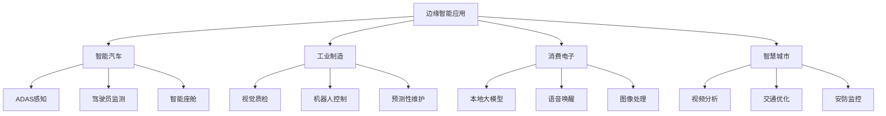
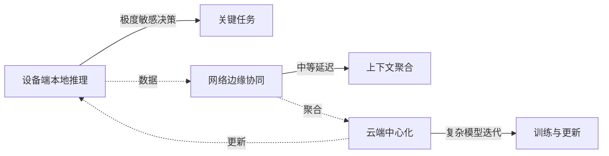
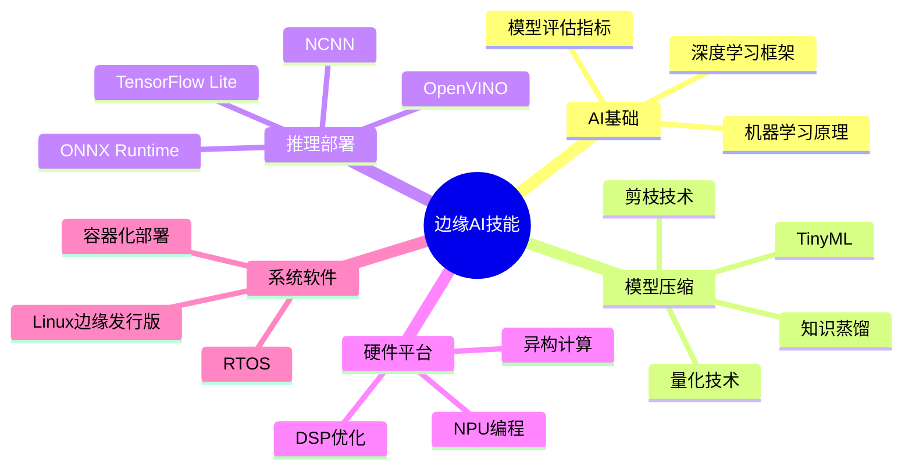

# 边缘智能行业分析

> [!abstract] 摘要
> 边缘智能（Edge AI）是将人工智能算法部署在靠近数据源的终端设备上，实现本地化推理的技术。2025-2026年进入规模化落地阶段，核心技术栈已成熟。

## 一、市场规模与发展趋势

### 全球市场规模

| 指标 | 数值 | 来源 |
|------|------|------|
| 2025年全球市场规模 | 250亿美元 | Grand View Research |
| 2033年预期规模 | 1180亿美元+ | Grand View Research |
| 年复合增长率 | 18.3% | 多方预测 |
| 2030年推理任务下移比例 | 50% | IDC预测 |

### 中国市场表现

- 2024年边缘计算市场规模：**突破950亿元**
- 同比增长：**超过30%**
- 2026年预期：**突破1300亿元**

> [!info] 关键趋势
> 到2030年，50%的企业AI推理任务将从云端下移到边缘设备或边缘节点本地处理。

## 二、核心驱动力

### 1. 低延迟需求

| 应用场景 | 延迟要求 | 云端延迟 | 边缘延迟 |
|----------|----------|----------|----------|
| 自动驾驶 | <10ms | 100-500ms | <10ms |
| 工业机器人 | <1ms | 100-500ms | <1ms |
| 增强现实 | <5ms | 100-500ms | <5ms |
| 智能质检 | <10ms | 100-500ms | <10ms |

### 2. 隐私安全

- **医疗数据**：敏感信息本地处理
- **金融交易**：数据不离设备
- **家庭监控**：隐私保护
- **企业机密**：合规要求

### 3. 成本优化

- 海量视频数据仅上传结构化信息
- 带宽需求降低**99%以上**
- 减少云端计算资源消耗

### 4. 技术栈成熟

```
┌─────────────────────────────────────────┐
│          边缘智能技术栈成熟              │
├─────────────────────────────────────────┤
│  AI模型：轻量化（剪枝/量化/蒸馏）        │
│  芯片：NPU/TCU/异构计算                 │
│  网络：5G商用/6G规划                    │
│  架构：端-边-云三层协同                 │
└─────────────────────────────────────────┘
```

## 三、典型应用场景

### 应用场景地图



### 行业应用详情

#### 智能汽车

- **ADAS系统**：车道偏离预警、行人检测
- **驾驶员监测**：疲劳检测、手势控制
- **智能座舱**：语音交互、情感识别

#### 工业制造

- **视觉质检**：实时产品缺陷检测
- **机器人控制**：动态避障、安全协作
- **预测性维护**：设备故障预警

#### 消费电子

- **手机端侧AI**：Gemini Nano、端侧大模型
- **可穿戴设备**：心率分析、异常预警
- **智能家居**：本地语音控制

## 四、产业链分析

### 产业链结构

```
上游（芯片与硬件）
├── AI芯片厂商
│   ├── 高通、联发科、苹果（手机端）
│   ├── 地平线、寒武纪、安霸（边缘专用）
│   └── 存内计算芯片（知存科技等）
├── 传感器
│   ├── 视觉传感器
│   ├── 麦克风阵列
│   └── IMU/雷达
└── 通信模组
    └── 5G/6G模组

中游（软件与服务）
├── AI框架
│   ├── TensorFlow Lite
│   ├── ONNX Runtime
│   ├── PyTorch Mobile
│   └── CMSIS-NN
├── 模型压缩
│   ├── 量化工具
│   ├── 剪枝工具
│   └── 蒸馏框架
└── 边缘计算平台
    ├── 云边协同平台
    └── 边缘管理平台

下游（应用与集成）
├── 系统集成商
├── 行业解决方案商
└── OEM厂商
```

### 关键技术环节

#### 1. 模型轻量化技术

| 技术 | 原理 | 压缩效果 |
|------|------|----------|
| **量化** | FP32→INT8/INT4 | 体积↓75%，速度↑3-5倍 |
| **剪枝** | 移除冗余参数 | 精度损失<5% |
| **知识蒸馏** | 大模型→小模型 | 保持核心能力 |
| **神经网络架构搜索** | 自动设计高效架构 | 针对性优化 |

#### 2. 边缘AI芯片

| 厂商 | 代表产品 | 算力 | 功耗 | 适用场景 |
|------|---------|------|------|----------|
| 高通 | Snapdragon 8 Gen4 | 100+ TOPS | 瓦级 | 手机 |
| 苹果 | A18 Pro | 35 TOPS | 毫瓦级 | 手机/平板 |
| 地平线 | 征程系列 | 0.5-10 TOPS | 毫瓦-瓦级 | 边缘/汽车 |
| ARM | Ethos-U | 毫瓦级 | 微瓦级 | IoT |
| NVIDIA | Jetson系列 | 几十TOPS | 几十瓦 | 边缘计算 |

#### 3. 存内计算技术

- **原理**：计算直接在存储单元内完成
- **优势**：消除"内存墙"，能效提升10倍+
- **代表公司**：知存科技、闪易半导体、Myhtic

## 五、技术架构

### 三层计算架构



| 层级 | 功能 | 延迟要求 | 典型场景 |
|------|------|----------|----------|
| **设备端** | 本地推理、关键决策 | 微秒级 | 紧急制动、实时控制 |
| **网络边缘** | 协同推理、上下文聚合 | 毫秒级 | 视频分析、多传感器融合 |
| **云端** | 模型训练、复杂推理 | 百毫秒级 | 大模型训练、非实时分析 |

## 六、学习路径

### 边缘AI技能地图



### 推荐学习资源

- **框架**：TensorFlow Lite、ONNX Runtime、Edge Impulse
- **课程**：吴恩达机器学习、李宏毅机器学习
- **实践平台**：STM32 AI套件、Jetson系列
- **社区**：地平线开发者社区、昇腾论坛

## 七、就业方向

### 岗位类型

| 岗位 | 技能要求 | 薪资范围(3年) | 优先级 |
|------|----------|---------------|--------|
| 边缘AI推理工程师 | 模型压缩/部署/优化 | 35-50万 | ⭐⭐⭐⭐⭐ |
| 嵌入式AI系统工程师 | 软硬协同/系统集成 | 40-55万 | ⭐⭐⭐⭐⭐ |
| AI加速库移植工程师 | 算子优化/硬件适配 | 45-60万 | ⭐⭐⭐⭐ |
| 边缘计算架构师 | 系统设计/性能调优 | 60-80万 | ⭐⭐⭐ |

### 职业发展建议

> [!tip] 转型建议
> 作为嵌入式工程师，建议优先选择**边缘AI推理工程师**方向，因为与现有技能重叠度高，学习曲线平缓。

## 八、相关笔记

- [[具身智能行业分析]] - 人形机器人与具身智能
- [[AI算子开发技术栈]] - 算子开发核心技术
- [[华为昇腾开发指南]] - 昇腾开发资源与路径
- [[嵌入式工程师转型指南]] - 转型路径与学习计划

---

> [!note] 更新记录
> - 2026-05-19：创建笔记，整合行业分析

