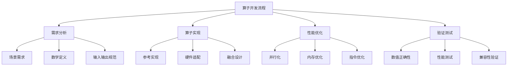
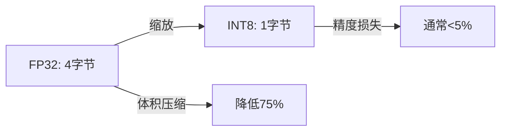
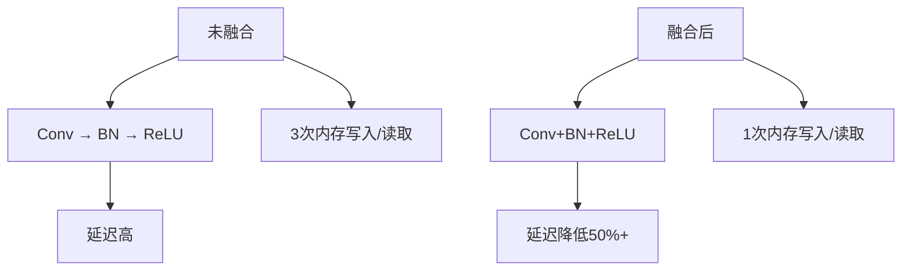
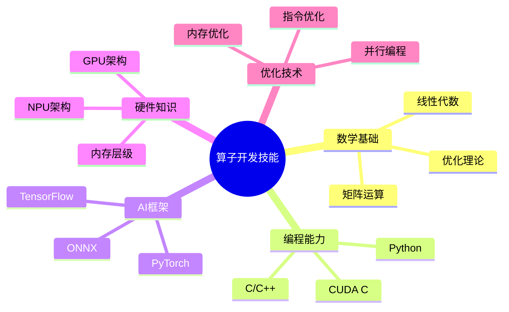

# AI算子开发技术栈

> [!abstract] 摘要
> AI算子是深度学习框架中的最小计算单元，算子开发是边缘AI和具身智能的核心底层技术。本笔记详细整理算子开发的知识体系、技术要点和实践指南。

## 一、算子基础概念

### 什么是AI算子

**算子（Operator）** 是深度学习框架中的最小计算单元，是构建神经网络的基础组件。

> [!quote] 算子的定义
> 算子接收输入张量（Tensor），执行特定计算，输出结果张量。每个算子实现特定的数学函数。

### 常见算子类型

#### 基础运算算子

| 算子 | 功能 | 场景 |
|------|------|------|
| Conv2D | 2D卷积 | CNN核心 |
| MatMul | 矩阵乘法 | 全连接层 |
| Add | 逐元素加法 | 残差连接 |
| Mul | 逐元素乘法 | 缩放操作 |

#### 激活函数算子

| 算子 | 功能 | 特点 |
|------|------|------|
| ReLU | 线性整流 | 稀疏激活 |
| Sigmoid | S形函数 | 二分类输出 |
| Tanh | 双曲正切 | 零中心输出 |
| Softmax | 归一化指数 | 多分类输出 |

#### 复杂算子

| 算子 | 功能 | 应用场景 |
|------|------|----------|
| LayerNorm | 层归一化 | Transformer |
| Attention | 注意力机制 | 大语言模型 |
| GEMM | 通用矩阵乘法 | BLAS核心 |
| Pooling | 池化操作 | 特征提取 |

## 二、算子开发流程

### 开发流程概览



### 步骤详解

#### 1. 需求分析

| 分析项 | 内容 | 示例 |
|--------|------|------|
| 场景需求 | 训练/推理、云端/边缘 | 边缘推理优先 |
| 数学定义 | 计算规则、公式 | 卷积的滑动窗口计算 |
| 输入输出 | Shape、DataType、Layout | NCHW、FP32 |

#### 2. 算子实现

**参考实现（Python）：**
```python
# PyTorch实现卷积
import torch.nn.functional as F
def conv2d_ref(input, weight, stride=1, padding=0):
    return F.conv2d(input, weight, stride=stride, padding=padding)
```

**高性能实现（C/C++）：**
```c
// CUDA实现卷积
__global__ void conv2d_kernel(float* output, float* input, float* weight, ...) {
    // 具体实现
}
```

#### 3. 性能优化

**优化维度：**
- 并行化：多线程/SIMT
- 内存优化：缓存/零拷贝
- 指令优化：SIMD/专用指令

#### 4. 验证测试

| 测试类型 | 目标 | 方法 |
|---------|------|------|
| 数值正确性 | 误差在容忍范围 | 与参考实现对比 |
| 性能测试 | 满足性能指标 | FLOPS/Latency |
| 兼容性测试 | 多平台适配 | 跨框架验证 |

## 三、模型量化技术

### 量化的核心原理

> [!tip] 量化本质
> 量化是通过"缩放因子"和"零点"，将FP32浮点数据映射到INT8定点数据，用微小的精度损失换取体积压缩和速度提升。

### 量化数学原理



**量化公式：**
```
q = round(x / scale + zero_point)
```

**量化参数：**
| 参数 | 作用 | 确定方式 |
|------|------|---------|
| Scale | 缩放因子 | 动态范围/256 |
| Zero Point | 零点偏移 | 最小值映射 |
| Quantization Granularity | 量化粒度 | 张量级/通道级 |

### 量化方案对比

| 方案 | 精度损失 | 实现难度 | 适用场景 |
|------|---------|---------|----------|
| PTQ（训练后量化） | 中等 | 低 | 快速部署 |
| QAT（量化感知训练） | 低 | 高 | 高精度需求 |
| 混合精度 | 低 | 高 | 复杂模型 |

### 量化工具链

| 框架 | 工具 | 特点 |
|------|------|------|
| TensorFlow | TFLite Converter | 成熟稳定 |
| PyTorch | PyTorch Quantization | 原生支持 |
| ONNX | ONNX Runtime | 跨框架 |
| TensorRT | INT8 Calibration | 高性能 |

## 四、算子融合技术

### 什么是算子融合

> [!quote] 算子融合
> 将多个相邻算子合并为单个融合算子，减少中间结果的内存访问，从而提升性能。

### 融合收益



### 常见融合模式

| 融合模式 | 包含算子 | 收益 |
|---------|---------|------|
| Conv+BN | 卷积+批归一化 | 减少2次内存访问 |
| Conv+ReLU | 卷积+激活 | 减少1次内存访问 |
| MatMul+Add | 矩阵乘+偏置 | 融合为GEMM |
| LayerNorm+Attention | 归一化+注意力 | 减少多次内存访问 |

### 融合算子开发

```c
// 融合卷积+ReLU示例
__global__ void conv_relu_fusion_kernel(
    float* output, float* input, float* weight,
    float* bn_scale, float* bn_bias, int n, int c, int h, int w) {
    
    // 卷积计算
    float conv_result = conv2d_calculation(input, weight);
    
    // 批归一化融合
    conv_result = conv_result * bn_scale + bn_bias;
    
    // ReLU融合
    conv_result = max(0, conv_result);
    
    output[idx] = conv_result;
}
```

## 五、边缘AI推理优化

### 边缘推理"三板斧"

> [!success] 核心优化技术
> 1. **量化**：压缩模型体积、降低计算量
> 2. **融合**：减少冗余开销、提升执行效率
> 3. **内存优化**：零拷贝调度、释放内存压力

### C语言实现AI推理

#### 为什么用C语言

| 优势 | 说明 |
|------|------|
| 无runtime依赖 | 可在几十KB RAM的设备上运行 |
| 内存完全可控 | 精准控制每一块内存 |
| 极致性能 | 接近硬件，最大化CPU算力 |

#### 量化实现示例

```c
// FP32到INT8量化
void quantize_fp32_to_int8(float* input, int8_t* output, 
                           float scale, int zero_point, int size) {
    for (int i = 0; i < size; i++) {
        float quantized = round(input[i] / scale) + zero_point;
        // 限制在INT8范围内
        quantized = quantized > 127 ? 127 : quantized;
        quantized = quantized < -128 ? -128 : quantized;
        output[i] = (int8_t)quantized;
    }
}
```

#### 算子融合示例

```c
// Conv+ReLU融合算子
void conv_relu_fused(int8_t* output, int8_t* input, int8_t* weight,
                     float input_scale, float weight_scale, 
                     int N, int C, int H, int W) {
    // 在循环内同时完成卷积和ReLU
    for (int n = 0; n < N; n++) {
        for (int c = 0; c < C; c++) {
            for (int h = 0; h < H; h++) {
                for (int w = 0; w < W; w++) {
                    int32_t sum = 0;
                    // 卷积计算
                    for (int k = 0; k < KERNEL_SIZE; k++) {
                        sum += input[n][c][h+k][w+k] * weight[c][k][k];
                    }
                    // ReLU融合（无需额外循环）
                    sum = sum > 0 ? sum : 0;
                    output[n][c][h][w] = sum;
                }
            }
        }
    }
}
```

## 六、主流芯片算子开发

### 芯片生态对比

| 芯片 | 编程框架 | 算子开发语言 | 生态成熟度 |
|------|---------|-------------|-----------|
| NVIDIA GPU | CUDA/cuDNN | CUDA C | ⭐⭐⭐⭐⭐ |
| 华为昇腾 | CANN | Ascend C / TBE DSL | ⭐⭐⭐⭐ |
| 寒武纪 | NeuWare | BangC | ⭐⭐⭐ |
| 地平线 | Horizon DNN | BPU自定义 | ⭐⭐⭐ |
| Intel CPU | oneDNN | ISPC/oneDNN | ⭐⭐⭐⭐ |

### NVIDIA GPU算子开发

#### CUDA编程模型

```cuda
// CUDA核函数示例
__global__ void matmul_kernel(float* C, const float* A, const float* B,
                               int M, int N, int K) {
    int row = blockIdx.y * blockDim.y + threadIdx.y;
    int col = blockIdx.x * blockDim.x + threadIdx.x;
    
    if (row < M && col < N) {
        float sum = 0.0f;
        for (int k = 0; k < K; k++) {
            sum += A[row * K + k] * B[k * N + col];
        }
        C[row * N + col] = sum;
    }
}
```

#### cuDNN API使用

```c
// 使用cuDNN卷积
cudnnHandle_t cudnn;
cudnnConvolutionFwdAlgo_t algo;
cudnnConvolutionForward(cudnn, &alpha, inputDesc, inputData,
                        filterDesc, filterData, convDesc, algo,
                        workspace, workspaceSize, &beta, outputDesc, outputData);
```

### 华为昇腾算子开发

#### Ascend C编程

```cpp
// Ascend C算子示例
class MatMulKernel {
public:
    __aicore__ inline void Process() {
        // 本地张量定义
        LocalTensor<float> inA = inQueueA.template GetFront<软mie<软mie>();
        LocalTensor<float> inB = inQueueB.template GetFront<软mie<软mie>();
        LocalTensor<float> outC = outQueueC.template Alloc<软mie<软mie>();
        
        // 矩阵乘法计算
        Mmda(inA, inB, outC);
        
        outQueueC.template PushBack<软mie<软mie>(outC);
    }
};
```

#### TBE DSL开发

```python
# TBE DSL实现卷积
import te.lang.cce
from te.platform.fusion_manager import fusion

@fusion(input_shapes=..., input_types=...)
def conv_compute(x, weight):
    # 定义卷积参数
    conv_attr = {
        'stride_h': 1, 'stride_w': 1,
        'pad_top': 1, 'pad_bottom': 1,
        'pad_left': 1, 'pad_right': 1
    }
    # 调用TE接口
    res = te.lang.cce.conv2d(x, weight, **conv_attr)
    return res
```

### 算子优化技术

#### Tiling策略

> [!warning] Tiling的重要性
> 由于芯片内存（UB/SRAM）有限，需要将大张量分块加载到片上内存进行处理。

```c
// Tiling策略示例
void tiled_matmul(float* A, float* B, float* C, int M, int N, int K) {
    const int TILE_SIZE = 16;  // 根据硬件UB大小确定
    
    for (int m = 0; m < M; m += TILE_SIZE) {
        for (int n = 0; n < N; n += TILE_SIZE) {
            for (int k = 0; k < K; k += TILE_SIZE) {
                // 加载Tile到片上内存
                load_tile(A, m, k);
                load_tile(B, k, n);
                
                // 计算当前Tile
                compute_tile(m, n, k);
                
                // 保存结果
                store_tile(C, m, n);
            }
        }
    }
}
```

#### 分核策略

```c
// 多核并行策略
void multi_core_parallel(float* data, int size) {
    // 假设有8个核可用
    int core_num = 8;
    int chunk_size = size / core_num;
    
    for (int i = 0; i < core_num; i++) {
        int start = i * chunk_size;
        int end = (i == core_num - 1) ? size : (i + 1) * chunk_size;
        // 每个核处理一段数据
        process_chunk(data, start, end);
    }
}
```

## 七、性能分析与调优

### Profiling工具

| 工具 | 平台 | 功能 |
|------|------|------|
| NVIDIA Nsight | GPU | CUDA性能分析 |
| Ascend Profiler | 昇腾 | NPU性能分析 |
| gprof | 通用 | 函数级分析 |
| perf | Linux | 硬件事件采样 |

### 性能指标

| 指标 | 定义 | 优化目标 |
|------|------|---------|
| FLOPS | 浮点运算数/秒 | 越高越好 |
| 延迟（Latency） | 单次执行时间 | 越低越好 |
| 吞吐量（Throughput） | 单位时间处理量 | 越高越好 |
| 内存带宽 | 内存数据传输速率 | 利用率高 |

### 优化策略清单

> [!checklist] 优化检查项
> - [ ] 算法层面：选择更高效的算法（如Winograd卷积）
> - [ ] 并行层面：充分利用多核/SIMD
> - [ ] 内存层面：优化数据布局、减少DDR访问
> - [ ] 指令层面：使用硬件特定指令
> - [ ] 编译层面：开启编译器优化（-O3）

## 八、学习路径与资源

### 算子开发技能树



### 推荐学习顺序

1. **数学基础**：线性代数、矩阵运算
2. **深度学习**：理解各种算子的原理
3. **PyTorch**：实现参考算子
4. **C/C++优化**：手写高性能算子
5. **CUDA/Ascend C**：硬件级优化
6. **Profiling**：性能分析与调优

### 推荐资源

| 资源类型 | 具体内容 | 难度 |
|---------|---------|------|
| 书籍 | 《CUDA编程》 | 中高 |
| 课程 | 深度学习专项课程 | 中 |
| 文档 | cuDNN Developer Guide | 高 |
| 文档 | CANN算子开发文档 | 中高 |
| 代码 | TVM源代码 | 高 |

## 九、相关笔记

- [[边缘智能行业分析]] - 边缘AI应用场景
- [[具身智能行业分析]] - 机器人算子需求
- [[华为昇腾开发指南]] - 昇腾算子开发实践
- [[嵌入式工程师转型指南]] - 转型路径规划

---

> [!note] 更新记录
> - 2026-05-19：创建笔记，整合算子开发技术栈

