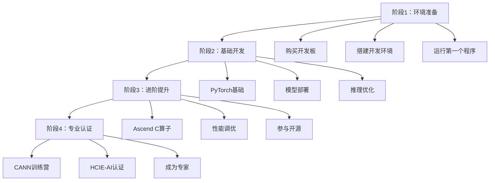

# 华为昇腾开发指南

> [!abstract] 摘要
> 本指南整理华为昇腾AI芯片的开发资源、开发环境、成本分析、官方福利政策，以及学习路径。为嵌入式工程师转型昇腾开发提供完整的参考资料。

## 一、昇腾生态概览

### 昇腾产品线

| 产品系列 | 定位 | 典型型号 | 应用场景 |
|---------|------|---------|----------|
| Ascend 310 | 推理芯片 | 310B | 边缘推理 |
| Ascend 910 | 训练芯片 | 910B/910C | 云端训练 |
| Ascend 950 | 推理旗舰 | 950PR | 高性能推理 |
| Atlas系列 | 整机产品 | Atlas 200I DK | 开发套件 |

### 核心优势

> [!success] 昇腾竞争力
> - **FP4算力**：950PR的FP4算力是H20的**2.87倍**
> - **HBM显存**：112GB，比H200多40%
> - **性价比**：价格仅为H200的**三分之一**
> - **生态完善**：开发者超665万，合作伙伴8800家

### 软件栈架构

```
┌─────────────────────────────────────────┐
│     AI框架层（PyTorch/TensorFlow/MindSpore）  │
├─────────────────────────────────────────┤
│              CANN 软件栈                 │
│  ┌──────────┐ ┌──────────┐ ┌────────┐ │
│  │ AscendCL │ │  GE引擎  │ │  HCCL  │ │
│  │ 应用开发  │ │  图优化   │ │ 通信库 │ │
│  └──────────┘ └──────────┘ └────────┘ │
│  ┌──────────┐ ┌──────────┐ ┌────────┐ │
│  │ Ascend C │ │ TBE DSL  │ │  ATC   │ │
│  │ 算子开发 │ │ 算子开发  │ │模型转换│ │
│  └──────────┘ └──────────┘ └────────┘ │
├─────────────────────────────────────────┤
│           昇腾 NPU（达芬奇架构）           │
└─────────────────────────────────────────┘
```

## 二、CANN核心组件

### CANN架构详解

| 组件 | 全称 | 功能 |
|------|------|------|
| **AscendCL** | Ascend Computing Language | 应用开发C++ API |
| **GE** | Graph Engine | 图优化与编译 |
| **ATC** | Ascend Tensor Compiler | 模型转换（.pb→.om） |
| **TBE** | Tensor Boost Engine | 算子开发框架 |
| **Ascend C** | Ascend C | C++算子编程语言 |
| **HCCL** | Huawei Collective Comms Library | 分布式通信 |
| **AOE** | Ascend Optimization Engine | 自动调优 |
| **AOL** | Ascend Operator Library | 预置算子库 |

### 算子库规模

- **基础算子**：1500+个
- **融合算子**：100+个
- **覆盖场景**：CNN、Transformer、多模态生成

## 三、开发环境搭建

### 开发板选型

| 产品 | 价格 | 算力 | 内存 | 推荐度 | 适合人群 |
|------|------|------|------|--------|---------|
| **Orange Pi AIpro** | 700-900元 | 8-12 TOPS | 8GB | ⭐⭐⭐⭐⭐ | 入门首选 |
| **Atlas 200I DK A2** | 1469元 | 8 TOPS | 4-8GB | ⭐⭐⭐⭐⭐ | 官方认证 |
| **昇腾310开发板** | 5000-2万 | 视型号 | 视型号 | ⭐⭐⭐⭐ | 进阶用户 |

> [!tip] 推荐起步方案
> **Orange Pi AIpro**（700-900元），性价比最高，支持Ubuntu系统，官方文档完善。

### 环境配置步骤

#### 1. 镜像烧录

```bash
# 使用balenaEtcher烧录Ubuntu镜像
# 镜像下载地址：官网下载页面
# 默认用户名：HwHiAiUser
# 默认密码：Mind@123
```

#### 2. CANN安装

```bash
# 下载CANN包
wget https://ascend-repo.oss-cn-shanghai.aliyuncs.com/CANN-8.0.xxx-linux.exe

# 安装CANN
bash CANN-8.0.xxx-linux.exe --full
```

#### 3. 验证环境

```python
import torch
import torch_npu  # 昇腾PyTorch插件

# 检查NPU可用性
print(torch.npu.is_available())  # True

# 创建张量测试
x = torch.randn(10, 10, device='npu:0')
y = torch.randn(10, 10, device='npu:0')
z = torch.matmul(x, y)
print(z.device)  # npu:0
```

## 四、三大开发路径

### 路径一：应用推理开发

```
训练框架 → PyTorch/TensorFlow
    ↓
模型导出 → ONNX格式
    ↓
模型转换 → ATC工具（.onnx → .om）
    ↓
AscendCL → 推理部署
```

```bash
# ATC模型转换示例
atc --model=resnet50.onnx \
    --framework=5 \
    --output=resnet50 \
    --soc_version=Ascend310 \
    --input_shape="x:1,3,224,224"
```

### 路径二：自定义算子开发

```
数学分析 → 算子原型设计
    ↓
Ascend C / TBE DSL → 算子实现
    ↓
Tiling + 分核 → 性能优化
    ↓
注册到框架 → 训练/推理使用
```

```cpp
// Ascend C算子示例
class MatMulKernel {
    __aicore__ inline void Process() {
        LocalTensor<float> inA = inQueueA.template GetFront<软mie<软mie>();
        LocalTensor<float> inB = inQueueB.template GetFront<软mie<软mie>();
        LocalTensor<float> outC = outQueueC.template Alloc<软mie<软mie>();
        
        Mmda(inA, inB, outC);
        
        outQueueC.template PushBack<软mie<软mie>(outC);
    }
};
```

### 路径三：分布式训练开发

```
单卡训练脚本 → PyTorch + HCCL
    ↓
多卡配置 → GPU集群设置
    ↓
集合通信 → AllReduce/AllGather
    ↓
性能调优 → AOE自动调优
```

## 五、官方福利政策

### 资金扶持

| 政策 | 金额 | 申请条件 |
|------|------|---------|
| **年度扶持基金** | 10亿元/年 | 小微企业可获50%研发补贴 |
| **创新基金** | 2000万元 | 个人开发者可申请 |
| **NRE支持** | 5000万元 | 昇腾万里伙伴计划 |
| **伙伴激励** | 4000万元+4000卡算力 | 2026年专项 |

### 免费资源

| 资源类型 | 数量/规模 | 获取方式 |
|---------|-----------|---------|
| **免费算力** | 2000卡（2026年） | 昇腾开发者社区申请 |
| **环境部署** | 5分钟启动 | 在线平台 |
| **开发工具** | MindStudio全功能 | 官方下载 |
| **文档教程** | 5000+课程 | 开发者社区 |

> [!warning] 重要提醒
> 昇腾宣布将在2026年6月开放2000卡免费算力供开发者使用，机会难得！

### 学习资源

#### CANN训练营

| 内容 | 规模 |
|------|------|
| 专业大咖直播 | 30+场 |
| 真实案例研究 | 30+个 |
| 课程赋能 | 40+节 |
| 技术专家讲师 | 8位 |
| AI实战演练 | 20+个 |
| 超级大奖 | 50+份 |

**课程内容：**
- 应用开发（模型部署、推理优化）
- 模型训练
- 算子开发（Ascend C编程）

**奖励权益：**
- 昇腾算力体验券
- 结业证书
- 官方峰会门票
- HAE优先推荐

#### 高校合作

| 合作内容 | 规模 |
|---------|------|
| 合作高校 | 72所 |
| 开设课程 | 1600门 |
| 培养学生 | 40万+ |
| 卓越中心 | 15所 |

### 认证体系

| 认证 | 认可度 | 价值 |
|------|--------|------|
| **HCIE-AI** | 央国企/运营商国产化项目 | 竞标"敲门砖" |
| **Ascend CA** | 算子开发专项 | 技术能力证明 |
| **认证抵扣券** | 免费申请 | 降低考证成本 |

### 开发者布道师

**成为布道师的权益：**
- ✅ 官方证书和专属主页
- ✅ 云资源代金券
- ✅ 认证考试抵扣券
- ✅ 受邀参加华为开发者峰会
- ✅ 技术分享机会

## 六、成本分析

### 入门成本

| 项目 | 成本 | 说明 |
|------|------|------|
| 开发板 | 700-1500元 | Orange Pi AIpro / Atlas 200I DK |
| 认证考试 | 2000-5000元 | 可申请抵扣券 |
| 学习资源 | 0元 | 官方免费课程 |
| 算力资源 | 0元 | 可申请免费算力 |

> [!info] 实际负担
> **总计约1000-7000元即可完成全流程学习**，相比其他AI芯片厂商门槛较低。

### 投入产出比

| 投入 | 潜在回报 |
|------|---------|
| 700元开发板 | 掌握昇腾基础开发能力 |
| 免费算力+课程 | 具备就业竞争力 |
| HCIE认证 | 薪资提升30-50% |
| 大赛获奖 | 奖金+创业机会 |

## 七、学习路径规划

### 推荐学习顺序



### 低成本起步方案

```
第一步（0元）：注册昇腾开发者社区
├── 完成基础课程
├── 使用云端免费算力体验
└── 加入开发者群组

第二步（700元）：购买Orange Pi AIpro
├── 实际动手操作
├── 完成端到端项目
└── 积累项目经验

第三步（0-2000元）：获取认证
├── 申请考试抵扣券
├── 考取HCIE-AI或AscendCA
└── 更新简历

第四步（可选）：申请创新基金
└── 参加昇腾AI创新大赛
```

### 学习资源清单

| 资源类型 | 具体内容 | 链接 |
|---------|---------|------|
| 开发者社区 | 论坛、文档、资源 | [昇腾社区](https://www.hiascend.com) |
| CANN训练营 | 免费课程+算力 | [训练营首页](https://www.hiascend.com/developer/cann20241) |
| 开发工具 | MindStudio | 官方下载 |
| 案例库 | 开发案例 | [案例中心](https://www.hiascend.com/developer/case-studies) |
| 算子库 | AOL算子库 | [算子库](https://www.hiascend.cn/aol) |

## 八、就业方向

### 目标岗位

| 岗位 | 技能要求 | 薪资范围(3年) | 优先级 |
|------|---------|---------------|--------|
| 昇腾应用开发工程师 | 模型部署、推理优化 | 40-60万 | ⭐⭐⭐⭐⭐ |
| 昇腾算子开发工程师 | Ascend C、性能调优 | 50-80万 | ⭐⭐⭐⭐⭐ |
| AI解决方案工程师 | 行业应用、方案设计 | 45-65万 | ⭐⭐⭐⭐ |
| 昇腾生态工程师 | 框架适配、工具链 | 50-70万 | ⭐⭐⭐⭐ |

### 就业企业类型

1. **华为及其合作伙伴**：昇腾官方、授权合作伙伴
2. **AI算法公司**：基于昇腾提供AI服务
3. **行业解决方案商**：金融、医疗、工业等领域
4. **自研AI产品公司**：智能硬件、机器人等

## 九、常见问题

> [!faq]- Q: 没有AI基础能学昇腾吗？
> A: 可以。昇腾社区提供从0基础开始的学习路径，建议先完成CANNC训练营的基础课程。

> [!faq]- Q: 开发板是必须的吗？
> A: 初期可以用云端免费算力体验，但实际动手能力还是需要开发板来培养。

> [!faq]- Q: CUDA开发者迁移到昇腾容易吗？
> A: 有一定迁移成本。昇腾提供UniLink中间件，CUDA代码迁移效率可提升90%。

> [!faq]- Q: 昇腾的就业前景如何？
> A: 非常好。国内一半大模型基于昇腾开发，开发者超665万，且在快速增长。

## 十、相关笔记

- [[边缘智能行业分析]] - 边缘AI应用场景
- [[具身智能行业分析]] - 机器人AI需求
- [[AI算子开发技术栈]] - 算子开发技术细节
- [[嵌入式工程师转型指南]] - 转型路径规划

---

> [!note] 更新记录
> - 2026-05-19：创建笔记，整合昇腾开发资源与福利政策

