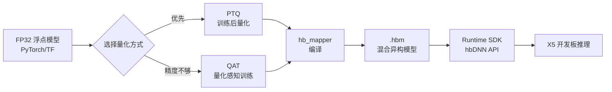

# 地平线旭日5（X5）算法工具链

> [!abstract] 摘要
> 地平线（d-robotics / Horizon Robotics）旭日 5（Sunrise5 / X5）是面向智能机器人与物联网场景的边缘 AI SoC。本笔记整理 X5 算法工具链（OE 天工开物）的体系结构、BPU 加速原理、算子支持清单以及端侧 AI 加速器的通用模式。

> [!info] 资料来源
> - 官方文档：[X5 算法工具链 v1.2.6 中文手册](https://developer.d-robotics.cc/api/v1/fileData/x5_doc-v126cn/index.html)
> - 算子清单：[supported_op_list_and_restrictions_release_x5_v1.2.6_cn.xlsx](https://developer.d-robotics.cc/api/v1/fileData/x5_doc-v126cn/supported_op_list_and_restrictions/supported_op_list_and_restrictions_release_x5_v1.2.6_cn.xlsx)
> - 相关笔记：[[../华为昇腾/开发指南]]、[[../AI算子开发/技术栈]]、[[../../04 - 资源/AI模型部署/模型量化]]

---

## 一、地平线公司 & 产品线

### 公司定位
- **全称**：地平线（Horizon Robotics）
- **地位**：国内领先的**边缘 AI 芯片**公司，主打车规级与机器人 AI 芯片
- **官网**：[developer.d-robotics.cc](https://developer.d-robotics.cc)

### 三大产品系列

| 系列 | 定位 | 典型应用 |
|------|------|----------|
| 征程（Journey）系列 | 车规级 AI 芯片 | 智能驾驶 ADAS/AD |
| 旭日（Sunrise）系列 | 通用边缘 AI SoC | 智能机器人、IoT、摄像头 |
| 墨卡（Mara）系列 | 视觉处理芯片 | 端侧视觉 |

> **旭日 5（X5）** 是旭日系列最新型号之一，本笔记聚焦 X5。

---

## 二、BPU 是什么

> [!quote] 概念
> **BPU（Brain Processing Unit，脑处理单元）** 是地平线**自研**的专用 AI 加速器 IP，集成在 X5 SoC 内部，专门负责神经网络推理（卷积、矩阵乘等密集计算）。

### 关键特性

1. **不是通用处理器**：CPU（ARM 核）跑控制流和复杂逻辑，**BPU 跑神经网络算子**。X5 上 ARM + BPU 协同工作，因此地平线把编译后的模型叫**"混合异构模型"**。
2. **INT8 定点计算**：BPU 硬件精度 = INT8（8 位定点）。这是为什么 X5 工具链**强制要求**把 FP32 模型先做**量化**才能跑。
3. **算子调度策略**：
   - 编译器自动把能在 BPU 跑的算子（Conv、MatMul、Pooling 等）放到 BPU
   - BPU 不支持的算子（复杂自定义 OP、TopK、Scatter 等）**回退到 ARM CPU** 跑
   - 开发者可通过 `hbDNNInferCtrlParam.bpuCoreId` 控制调度到哪个 BPU 核
4. **配套软件层**：BPU 在 SDK 中封装为 `hbDNN*` 系列 C API（`hbDNNInitializeFromFiles`、`hbDNNInfer`、`hbDNNTensor` 等）

### BPU 与 NPU 的关系
- **NPU（Neural Processing Unit）** 是行业统称
- **BPU、TPU（谷歌）、NPU（华为）、MLU（寒武纪）、Hexagon（高通）、ANE（苹果）** 实质都是**专用 AI 加速器 ASIC**
- 区别主要在架构、算子覆盖度、框架耦合度

> 详细横向对比见 [[NPU横向对比]]

---

## 三、OE 天工开物（Open Explorer）

> [!quote] 概念
> **OE（Open Explorer，天工开物）** 是地平线基于自研计算平台打造的全生命周期开发平台，X5 工具链就是 OE 的一个子集。

### 三大功能模块

| 模块 | 作用 |
|------|------|
| **模型编译优化工具集** | 模型量化、优化、编译、调试，把 FP32 模型转成能在 X5 上跑的 `.hbm` 文件 |
| **算法仓库（model_zoo）** | 开源最佳实践算法（检测/分类/分割等），方便二次开发 |
| **应用开发 SDK** | Runtime API（`hbDNN*`），在板端加载模型、做推理；支持 ARM 真机和 x86 仿真 |

### 工具链发布物
- **`package.board`**：板端可执行程序（`hrt_model_exec`、`hrt_bin_dump` 等）
- **`package.host`**：x86 开发机的环境依赖
- **`samples/`**：示例代码（`ai_benchmark`、`ai_toolchain`、`model_zoo`）
- **`Docker 镜像`**：预置使用示例包所需的开发环境

---

## 四、X5 工具链工作流

### 完整流程图



### 关键技术概念

| 概念 | 含义 |
|------|------|
| **原始浮点模型** | PyTorch/TF 训练出的 FP32 模型 |
| **混合异构模型** | 能在 X5 上跑、能同时调用 ARM CPU 和 BPU 的模型 |
| **hbm 文件** | Horizon BPU Model，HBDK 编译器生成的模型文件，含 BPU 指令、参数、IO 描述 |
| **PTQ** | Post-Training Quantization，用校准数据把现成模型转定点，**无需重新训练**（推荐先试） |
| **QAT** | Quantization-Aware Training，在训练阶段插入伪量化节点，精度更好但成本高 |
| **张量** | 算子计算数据的容器，含 shape、排布、数据类型 |
| **数据排布** | NCHW（按通道）vs NHWC（按像素），影响计算性能 |

> [!tip] 数据精度
> - **GPU 训练**：FP32 / FP16
> - **BPU 推理**：INT8（少数算子支持 INT16 输入输出）
> - 量化粒度：per-tensor / per-axis / per-channel

### 工具链支持范围

> [!warning] 输入模型约束
> - 仅支持 **ONNX opset10** 和 **opset11**
> - TensorFlow 1.x 可通过 `tensorflow-onnx` 转出，**TF2.x 还是实验性**
> - 标记为 PyTorch 的 op（opset11 不包含）有专门的导出脚本支持

---

## 五、关键章节速查（X5 文档目录）

| 章节 | 内容 |
|------|------|
| 1. OE 文档脉络 | 文档导览 |
| 2. 产品简介 | OE 是什么、工具链概览 |
| 3. 关键概念 | 浮点/异构模型、hbm、算子、张量、PTQ/QAT |
| 4. 环境安装 | Docker、OE 包版本管理 |
| 5. 快速入门 | PTQ/QAT 快速上手 |
| 6. PTQ | 训练后量化的原理、工具、步骤、示例 |
| 7. QAT | 量化感知训练的开发指南、API 参考 |
| 8. 性能/精度调优 | 模型调优方法论 |
| 9. Runtime SDK | **BPU SDK API 手册**、嵌入式应用开发 |
| 10. Horizon Torch Samples | HAT 示例框架 |
| 11. Benchmark | 模型性能数据 |
| 12. 附录 | 算子支持约束、数据集、缩略语 |

---

## 六、X5 Runtime API（C SDK）

核心数据结构（在 `hbDNNTensorProperties.h` 中定义）：

```c
// 张量属性
typedef struct {
  hbDNNTensorShape validShape;     // 有效形状
  hbDNNTensorShape alignedShape;   // 对齐形状
  int32_t tensorLayout;            // NHWC / NCHW
  int32_t tensorType;              // INT8/FP16/NV12/YUV...
  hbDNNQuantiShift shift;          // 量化偏移
  hbDNNQuantiScale scale;          // 量化缩放
  hbDNNQuantiType quantiType;      // NONE/SHIFT/SCALE
  int32_t quantizeAxis;
  int32_t alignedByteSize;
  int32_t stride[8];
} hbDNNTensorProperties;

// 推理控制参数
typedef struct {
  int32_t bpuCoreId;     // BPU 核 ID（X5 仅 1 核）
  int32_t priority;      // 任务优先级
  int32_t more;          // 后续是否有跟随任务
  int64_t customId;      // 自定义优先级
} hbDNNInferCtrlParam;
```

### 典型推理流程

```c
// 1. 加载模型
hbPackedDNNHandle_t packed;
hbDNNInitializeFromFiles(&packed, model_paths, model_count);

// 2. 获取模型句柄
hbDNNHandle_t dnn;
hbDNNGetModelHandle(&dnn, packed, 0);

// 3. 准备输入 Tensor
hbDNNTensor input;
hbDNNGetInputTensorProperties(&input.properties, dnn, 0);
// ... 申请内存、拷贝数据到 input.sysMem

// 4. 推理
hbDNNInferCtrlParam ctrl;
HB_DNN_INITIALIZE_INFER_CTRL_PARAM(&ctrl);
hbDNNInfer(&task_handle, &output, &input, dnn, &ctrl);

// 5. 等待完成
hbDNNWaitTaskDone(task_handle, 0);

// 6. 释放
hbDNNReleaseTask(task_handle);
hbDNNRelease(packed);
```

---

## 七、X5 算子支持清单（v1.2.6）

> [!info] 通用硬约束
> 所有跑在 BPU 上的算子都必须满足：
> 1. **维度 = 4**（除少数显式声明支持非四维的）
> 2. **shape 上限**：最高维 ∈ [1, 4096]，其他维 ∈ [1, 65536]
> 3. **内存上限**：H × W × C ≤ 1G bytes
> 4. **类型支持**：float / int32 / int8

### 🟢 BPU 加速（29 个）

| 类别 | 算子 |
|------|------|
| 卷积类 | Convolution、Deconvolution、Pooling、InnerProduct |
| 归一化 | BatchNorm |
| 激活 | ELU、ReLU/LeakyRelu、PReLU、Sigmoid、TanH、AbsVal、Exp、Log、Power |
| 元素级 | Eltwise（Add/Sub/Mul）、Bias、Scale |
| 排序/索引 | Softmax、ArgMax |
| 形状变换 | Reshape、Concat、Split、Slice、Permute、Dropout、PassThrough |
| 矩阵/上采样 | MatMul、Upsample |
| 循环 | LSTM（仅 batch=1） |

### 🟡 仅 CPU 计算（约 18 个）

MaxUnpool、SPP、LRN、MVN、BNLL、Threshold、Reduction、Flatten、Crop、Normalize、CReLU、RReLU、ROIPooling、PSROIPooling、PriorBox、DetectionOutput 等

> **元算子**（`Cast / Constant / Dropout / Reshape / Squeeze / Unsqueeze / Shape`）无法直接跑 BPU，工具链会做**常量折叠**等优化让它们消失。

### 主动量化 vs 被动量化

> [!warning] 一个符合约束的 op 仍可能跑 CPU
> 原因在于**主动/被动量化**机制：
> - **主动量化**：计算密集型算子（Conv）→ 量化后直接落 BPU
> - **被动量化**：非计算密集型算子（Concat）→ **只有当前后节点都主动量化时才会被"吸入"BPU**
> - **手动量化**：开发者显式指定
>
> 详见：[地平线社区文章](https://developer.horizon.ai/forumDetail/118364000835765793)

### 常见踩坑点

- **Deconvolution pads**：必须 `hstart==hend 且 wstart==wend`
- **PReLU**：slope shape 必须是 1×1、1×W、H×1、或者与 data 完全相同
- **MatMul broadcast**：限制严格（如 `H1MK vs 1DKN` 不支持）
- **Softmax**：默认跑 CPU，跑 BPU 必须 `axis ∈ {1,2,3}` 且输入 4 维，并用 `run_on_bpu` 显式指定
- **LSTM**：BPU 上仅支持 `batch=1`

---

## 八、端侧 AI 加速器通用模式

> [!tip] 一句话总结
> **所有端侧 AI 加速器（BPU/NPU/TPU/MLU）的工作流都是同一个模板：FP32 → 量化 → 编译 → 板端推理，区别只在名字、工具链名称和算子覆盖度。**

### 共同设计哲学

1. **硬件只懂 INT8 定点** → 必须量化
2. **不通用、只跑算子** → 必须有"算子支持清单"
3. **全跑硬件不现实** → 必须有 CPU fallback / 异构
4. **量化会掉精度** → 必须有 PTQ 校准 + QAT 重训
5. **硬件不直接被调** → 必须有 SDK 封装好 API

### 学习顺序建议

```
1. 先搞懂量化原理（PTQ、QAT、per-tensor/per-channel、calibration）  ← 行业通用
        ↓
2. 再搞懂算子图优化（融合、constant folding、layout 转换）         ← 行业通用
        ↓
3. 最后看具体工具链命令（OE/CANN/SNPE/edgetpu_compiler）           ← 厂商特化
```

> 第 1、2 步是**通用知识**，迁移到任何 NPU 都通用；第 3 步才是厂商特定。

详细对比见 [[NPU横向对比]]

---

## 九、相关资源

### 官方
- [地平线开发者中心](https://developer.d-robotics.cc)
- [X5 文档 v1.2.6](https://developer.d-robotics.cc/api/v1/fileData/x5_doc-v126cn/index.html)
- [算子支持清单 v1.2.6](https://developer.d-robotics.cc/api/v1/fileData/x5_doc-v126cn/supported_op_list_and_restrictions/supported_op_list_and_restrictions_release_x5_v2.6_cn.xlsx)

### 社区
- [地平线开发者社区](https://developer.horizon.ai)
- 量化机制详解：https://developer.horizon.ai/forumDetail/118364000835765793

### 相关笔记
- [[../华为昇腾/开发指南]] —— 另一家国产 AI 芯片对比参考
- [[../AI算子开发/技术栈]] —— 算子开发通用知识
- [[../边缘智能/行业分析]] —— 边缘 AI 行业概览
- [[../../04 - 资源/AI模型部署/模型量化]] —— 量化原理
- [[../../04 - 资源/AI模型部署/板端部署]] —— 板端部署方法论

### 训练数据
- Docker 镜像、模型发布物、示例包 → 见 OE 包内 `samples/` 目录

---

## 十、待补充

- [ ] 实际跑一遍 PTQ 流程，记录命令和踩坑
- [ ] 跑一个 YOLOv5/YOLOv8 demo 在 X5 板上的 benchmark
- [ ] 对比 X5 和昇腾 310B 在同一模型上的性能
- [ ] 调研天工开物 SkyWalking 调试工具的用法
- [ ] 关注征程 5/6（J5/J6）车规芯片的差异
